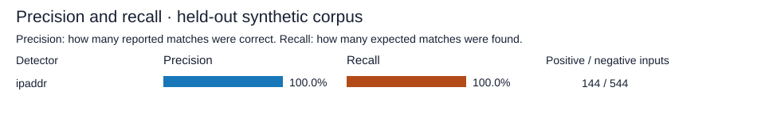
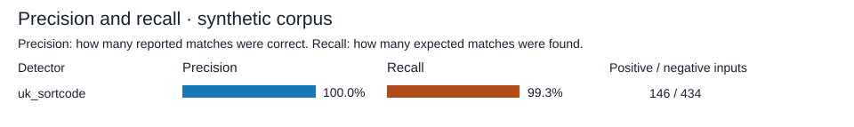

# Synthetic accuracy corpus

## Conditions

The development set uses Python `random.Random(20261115)`; the held-out set uses `random.Random(20270129)` and six different surrounding templates. Both were fixed before detector changes. Tuning used development failures and independent code-review regressions; the held-out evaluation rejected a stricter SWIFT context rule because it reduced recall. We treated this as overfitting and reverted the rule; no held-out failure was used to tune the retained changes.

Development contains 13,340 evaluations; held-out contains 12,880. The [generator](../scripts/generate_accuracy.py) constructs values and original byte ranges without invoking embargo. Development includes hand-written controls; held-out includes only independently generated values and controls. Repeated surroundings reuse values, and deterministic format examples such as email names and date cycles occur in both sets. Counts are not independent statistical trials. This is synthetic evaluation, not evidence of production accuracy or credential validity.

Surroundings include logs, JSON, URLs, line endings and Japanese text. Negative controls include hashes, UUIDs, timestamps, order/invoice/tracking identifiers, versions, invalid checksums and malformed credentials. Labels and templates are not a substitute for a real-world corpus.

A hit requires the same kind and exact unused original byte range. Partial, duplicate and extra matches count as false positives; missing expected ranges count as false negatives. Precision is TP/(TP+FP); recall is TP/(TP+FN). Each detector runs alone.

The default minimum confidence remains 0: ambiguous candidates are included. Confidence is a heuristic, not a probability. PAN checksum failures score 0.6; PAN, My Number and Japanese phone candidates with an attached order, invoice, tracking, version, build, serial or shipment label score 0.4. `WithMinConfidence(0.7)` excludes these candidates and can therefore miss genuine secrets under misleading business labels. A global 0.7 threshold also removes the 0.5–0.65 bank-account findings and some sort-code findings; it is not a universal accuracy setting. Both policies are measured below; the README chart uses held-out results at the default threshold.

## Encoding policy

The original 23 built-in detectors decode exactly one layer of valid `%HH` escapes anywhere in the input before detection. Findings map back to original bytes, so masking covers the escaped representation. Literal `+` and malformed percent escapes remain unchanged. Custom detectors receive the original bytes. Base64, hexadecimal, HTML entities, JSON escapes and recursively percent-encoded forms are not decoded by Scanner; decode application fields explicitly when needed. The logger adapters separately decode JSON strings at their output boundary.

[Round-trip and offset properties](../scanner_encoding_test.go) exercise random partial escaping and all byte values. [Regression tests](../tests/accuracy_regression_test.go) reject new mismatches and obsolete exceptions in both sets. Known limits retain reasons in [development](../tests/testdata/accuracy_limits.jsonl) and [held-out](../tests/testdata/accuracy_held_limits.jsonl) fixtures.

## Held-out results: default threshold 0


| Detector | Positive / negative inputs | TP / FP / FN spans | Precision | Recall |
|---|---:|---:|---:|---:|
| [aba_routing](#aba-routing) | 144 / 416 | 144 / 0 / 0 | 100.0% | 100.0% |
| [ach_trace](#ach-trace) | 144 / 416 | 144 / 0 / 0 | 100.0% | 100.0% |
| [awskey](#awskey) | 144 / 416 | 144 / 0 / 0 | 100.0% | 100.0% |
| [bank_account](#bank-account) | 144 / 416 | 144 / 0 / 0 | 100.0% | 100.0% |
| [btc](#btc) | 144 / 416 | 144 / 0 / 0 | 100.0% | 100.0% |
| [card_expiry](#card-expiry) | 144 / 416 | 144 / 0 / 0 | 100.0% | 100.0% |
| [cvv](#cvv) | 144 / 416 | 144 / 0 / 0 | 100.0% | 100.0% |
| [email](#email) | 144 / 416 | 144 / 0 / 0 | 100.0% | 100.0% |
| [eth](#eth) | 144 / 416 | 144 / 0 / 0 | 100.0% | 100.0% |
| [github_token](#github-token) | 144 / 416 | 144 / 0 / 0 | 100.0% | 100.0% |
| [google_api_key](#google-api-key) | 144 / 416 | 144 / 0 / 0 | 100.0% | 100.0% |
| [iban](#iban) | 144 / 416 | 144 / 0 / 0 | 100.0% | 100.0% |
| [ipaddr](#ipaddr) | 144 / 416 | 144 / 0 / 0 | 100.0% | 100.0% |
| [jwt](#jwt) | 144 / 416 | 144 / 0 / 0 | 100.0% | 100.0% |
| [merchant_id](#merchant-id) | 144 / 416 | 144 / 0 / 0 | 100.0% | 100.0% |
| [mynumber](#mynumber) | 144 / 416 | 144 / 32 / 0 | 81.8% | 100.0% |
| [pan](#pan) | 144 / 416 | 144 / 96 / 0 | 60.0% | 100.0% |
| [payment_token](#payment-token) | 144 / 416 | 144 / 0 / 0 | 100.0% | 100.0% |
| [phone_jp](#phone-jp) | 144 / 416 | 144 / 32 / 0 | 81.8% | 100.0% |
| [private_key_pem](#private-key-pem) | 144 / 416 | 144 / 0 / 0 | 100.0% | 100.0% |
| [slack_token](#slack-token) | 144 / 416 | 144 / 0 / 0 | 100.0% | 100.0% |
| [swiftbic](#swiftbic) | 144 / 416 | 144 / 0 / 0 | 100.0% | 100.0% |
| [uk_sortcode](#uk-sortcode) | 144 / 416 | 144 / 0 / 0 | 100.0% | 100.0% |

## Development results: default threshold 0

| Detector | Positive / negative inputs | TP / FP / FN spans | Precision | Recall |
|---|---:|---:|---:|---:|
| [aba_routing](#aba-routing) | 146 / 434 | 146 / 0 / 0 | 100.0% | 100.0% |
| [ach_trace](#ach-trace) | 146 / 434 | 146 / 0 / 0 | 100.0% | 100.0% |
| [awskey](#awskey) | 146 / 434 | 146 / 0 / 0 | 100.0% | 100.0% |
| [bank_account](#bank-account) | 146 / 434 | 146 / 0 / 0 | 100.0% | 100.0% |
| [btc](#btc) | 146 / 434 | 146 / 0 / 0 | 100.0% | 100.0% |
| [card_expiry](#card-expiry) | 146 / 434 | 146 / 0 / 0 | 100.0% | 100.0% |
| [cvv](#cvv) | 146 / 434 | 146 / 0 / 0 | 100.0% | 100.0% |
| [email](#email) | 146 / 434 | 146 / 0 / 0 | 100.0% | 100.0% |
| [eth](#eth) | 146 / 434 | 146 / 0 / 0 | 100.0% | 100.0% |
| [github_token](#github-token) | 146 / 434 | 146 / 0 / 0 | 100.0% | 100.0% |
| [google_api_key](#google-api-key) | 146 / 434 | 146 / 0 / 0 | 100.0% | 100.0% |
| [iban](#iban) | 146 / 434 | 146 / 0 / 0 | 100.0% | 100.0% |
| [ipaddr](#ipaddr) | 146 / 434 | 146 / 0 / 0 | 100.0% | 100.0% |
| [jwt](#jwt) | 146 / 434 | 146 / 0 / 0 | 100.0% | 100.0% |
| [merchant_id](#merchant-id) | 146 / 434 | 146 / 0 / 0 | 100.0% | 100.0% |
| [mynumber](#mynumber) | 146 / 434 | 146 / 33 / 0 | 81.6% | 100.0% |
| [pan](#pan) | 146 / 434 | 146 / 97 / 0 | 60.1% | 100.0% |
| [payment_token](#payment-token) | 146 / 434 | 146 / 0 / 0 | 100.0% | 100.0% |
| [phone_jp](#phone-jp) | 146 / 434 | 146 / 32 / 0 | 82.0% | 100.0% |
| [private_key_pem](#private-key-pem) | 146 / 434 | 146 / 0 / 0 | 100.0% | 100.0% |
| [slack_token](#slack-token) | 146 / 434 | 146 / 0 / 0 | 100.0% | 100.0% |
| [swiftbic](#swiftbic) | 146 / 434 | 146 / 120 / 0 | 54.9% | 100.0% |
| [uk_sortcode](#uk-sortcode) | 146 / 434 | 146 / 0 / 0 | 100.0% | 100.0% |

## Held-out results: minimum confidence 0.5

| Detector | Positive / negative inputs | TP / FP / FN spans | Precision | Recall |
|---|---:|---:|---:|---:|
| [aba_routing](#aba-routing) | 144 / 416 | 144 / 0 / 0 | 100.0% | 100.0% |
| [ach_trace](#ach-trace) | 144 / 416 | 144 / 0 / 0 | 100.0% | 100.0% |
| [awskey](#awskey) | 144 / 416 | 144 / 0 / 0 | 100.0% | 100.0% |
| [bank_account](#bank-account) | 144 / 416 | 144 / 0 / 0 | 100.0% | 100.0% |
| [btc](#btc) | 144 / 416 | 144 / 0 / 0 | 100.0% | 100.0% |
| [card_expiry](#card-expiry) | 144 / 416 | 144 / 0 / 0 | 100.0% | 100.0% |
| [cvv](#cvv) | 144 / 416 | 144 / 0 / 0 | 100.0% | 100.0% |
| [email](#email) | 144 / 416 | 144 / 0 / 0 | 100.0% | 100.0% |
| [eth](#eth) | 144 / 416 | 144 / 0 / 0 | 100.0% | 100.0% |
| [github_token](#github-token) | 144 / 416 | 144 / 0 / 0 | 100.0% | 100.0% |
| [google_api_key](#google-api-key) | 144 / 416 | 144 / 0 / 0 | 100.0% | 100.0% |
| [iban](#iban) | 144 / 416 | 144 / 0 / 0 | 100.0% | 100.0% |
| [ipaddr](#ipaddr) | 144 / 416 | 144 / 0 / 0 | 100.0% | 100.0% |
| [jwt](#jwt) | 144 / 416 | 144 / 0 / 0 | 100.0% | 100.0% |
| [merchant_id](#merchant-id) | 144 / 416 | 144 / 0 / 0 | 100.0% | 100.0% |
| [mynumber](#mynumber) | 144 / 416 | 144 / 0 / 0 | 100.0% | 100.0% |
| [pan](#pan) | 144 / 416 | 144 / 64 / 0 | 69.2% | 100.0% |
| [payment_token](#payment-token) | 144 / 416 | 144 / 0 / 0 | 100.0% | 100.0% |
| [phone_jp](#phone-jp) | 144 / 416 | 144 / 0 / 0 | 100.0% | 100.0% |
| [private_key_pem](#private-key-pem) | 144 / 416 | 144 / 0 / 0 | 100.0% | 100.0% |
| [slack_token](#slack-token) | 144 / 416 | 144 / 0 / 0 | 100.0% | 100.0% |
| [swiftbic](#swiftbic) | 144 / 416 | 144 / 0 / 0 | 100.0% | 100.0% |
| [uk_sortcode](#uk-sortcode) | 144 / 416 | 144 / 0 / 0 | 100.0% | 100.0% |

## Development results: minimum confidence 0.5

| Detector | Positive / negative inputs | TP / FP / FN spans | Precision | Recall |
|---|---:|---:|---:|---:|
| [aba_routing](#aba-routing) | 146 / 434 | 146 / 0 / 0 | 100.0% | 100.0% |
| [ach_trace](#ach-trace) | 146 / 434 | 146 / 0 / 0 | 100.0% | 100.0% |
| [awskey](#awskey) | 146 / 434 | 146 / 0 / 0 | 100.0% | 100.0% |
| [bank_account](#bank-account) | 146 / 434 | 146 / 0 / 0 | 100.0% | 100.0% |
| [btc](#btc) | 146 / 434 | 146 / 0 / 0 | 100.0% | 100.0% |
| [card_expiry](#card-expiry) | 146 / 434 | 146 / 0 / 0 | 100.0% | 100.0% |
| [cvv](#cvv) | 146 / 434 | 146 / 0 / 0 | 100.0% | 100.0% |
| [email](#email) | 146 / 434 | 146 / 0 / 0 | 100.0% | 100.0% |
| [eth](#eth) | 146 / 434 | 146 / 0 / 0 | 100.0% | 100.0% |
| [github_token](#github-token) | 146 / 434 | 146 / 0 / 0 | 100.0% | 100.0% |
| [google_api_key](#google-api-key) | 146 / 434 | 146 / 0 / 0 | 100.0% | 100.0% |
| [iban](#iban) | 146 / 434 | 146 / 0 / 0 | 100.0% | 100.0% |
| [ipaddr](#ipaddr) | 146 / 434 | 146 / 0 / 0 | 100.0% | 100.0% |
| [jwt](#jwt) | 146 / 434 | 146 / 0 / 0 | 100.0% | 100.0% |
| [merchant_id](#merchant-id) | 146 / 434 | 146 / 0 / 0 | 100.0% | 100.0% |
| [mynumber](#mynumber) | 146 / 434 | 146 / 0 / 0 | 100.0% | 100.0% |
| [pan](#pan) | 146 / 434 | 146 / 64 / 0 | 69.5% | 100.0% |
| [payment_token](#payment-token) | 146 / 434 | 146 / 0 / 0 | 100.0% | 100.0% |
| [phone_jp](#phone-jp) | 146 / 434 | 146 / 0 / 0 | 100.0% | 100.0% |
| [private_key_pem](#private-key-pem) | 146 / 434 | 146 / 0 / 0 | 100.0% | 100.0% |
| [slack_token](#slack-token) | 146 / 434 | 146 / 0 / 0 | 100.0% | 100.0% |
| [swiftbic](#swiftbic) | 146 / 434 | 146 / 120 / 0 | 54.9% | 100.0% |
| [uk_sortcode](#uk-sortcode) | 146 / 434 | 146 / 0 / 0 | 100.0% | 100.0% |

## Held-out results: minimum confidence 0.7

| Detector | Positive / negative inputs | TP / FP / FN spans | Precision | Recall |
|---|---:|---:|---:|---:|
| [aba_routing](#aba-routing) | 144 / 416 | 144 / 0 / 0 | 100.0% | 100.0% |
| [ach_trace](#ach-trace) | 144 / 416 | 144 / 0 / 0 | 100.0% | 100.0% |
| [awskey](#awskey) | 144 / 416 | 144 / 0 / 0 | 100.0% | 100.0% |
| [bank_account](#bank-account) | 144 / 416 | 0 / 0 / 144 | n/a | 0.0% |
| [btc](#btc) | 144 / 416 | 144 / 0 / 0 | 100.0% | 100.0% |
| [card_expiry](#card-expiry) | 144 / 416 | 144 / 0 / 0 | 100.0% | 100.0% |
| [cvv](#cvv) | 144 / 416 | 144 / 0 / 0 | 100.0% | 100.0% |
| [email](#email) | 144 / 416 | 144 / 0 / 0 | 100.0% | 100.0% |
| [eth](#eth) | 144 / 416 | 144 / 0 / 0 | 100.0% | 100.0% |
| [github_token](#github-token) | 144 / 416 | 144 / 0 / 0 | 100.0% | 100.0% |
| [google_api_key](#google-api-key) | 144 / 416 | 144 / 0 / 0 | 100.0% | 100.0% |
| [iban](#iban) | 144 / 416 | 144 / 0 / 0 | 100.0% | 100.0% |
| [ipaddr](#ipaddr) | 144 / 416 | 144 / 0 / 0 | 100.0% | 100.0% |
| [jwt](#jwt) | 144 / 416 | 144 / 0 / 0 | 100.0% | 100.0% |
| [merchant_id](#merchant-id) | 144 / 416 | 144 / 0 / 0 | 100.0% | 100.0% |
| [mynumber](#mynumber) | 144 / 416 | 144 / 0 / 0 | 100.0% | 100.0% |
| [pan](#pan) | 144 / 416 | 144 / 0 / 0 | 100.0% | 100.0% |
| [payment_token](#payment-token) | 144 / 416 | 144 / 0 / 0 | 100.0% | 100.0% |
| [phone_jp](#phone-jp) | 144 / 416 | 144 / 0 / 0 | 100.0% | 100.0% |
| [private_key_pem](#private-key-pem) | 144 / 416 | 144 / 0 / 0 | 100.0% | 100.0% |
| [slack_token](#slack-token) | 144 / 416 | 144 / 0 / 0 | 100.0% | 100.0% |
| [swiftbic](#swiftbic) | 144 / 416 | 144 / 0 / 0 | 100.0% | 100.0% |
| [uk_sortcode](#uk-sortcode) | 144 / 416 | 138 / 0 / 6 | 100.0% | 95.8% |

## Development results: minimum confidence 0.7

| Detector | Positive / negative inputs | TP / FP / FN spans | Precision | Recall |
|---|---:|---:|---:|---:|
| [aba_routing](#aba-routing) | 146 / 434 | 146 / 0 / 0 | 100.0% | 100.0% |
| [ach_trace](#ach-trace) | 146 / 434 | 146 / 0 / 0 | 100.0% | 100.0% |
| [awskey](#awskey) | 146 / 434 | 146 / 0 / 0 | 100.0% | 100.0% |
| [bank_account](#bank-account) | 146 / 434 | 0 / 0 / 146 | n/a | 0.0% |
| [btc](#btc) | 146 / 434 | 146 / 0 / 0 | 100.0% | 100.0% |
| [card_expiry](#card-expiry) | 146 / 434 | 146 / 0 / 0 | 100.0% | 100.0% |
| [cvv](#cvv) | 146 / 434 | 146 / 0 / 0 | 100.0% | 100.0% |
| [email](#email) | 146 / 434 | 146 / 0 / 0 | 100.0% | 100.0% |
| [eth](#eth) | 146 / 434 | 146 / 0 / 0 | 100.0% | 100.0% |
| [github_token](#github-token) | 146 / 434 | 146 / 0 / 0 | 100.0% | 100.0% |
| [google_api_key](#google-api-key) | 146 / 434 | 146 / 0 / 0 | 100.0% | 100.0% |
| [iban](#iban) | 146 / 434 | 146 / 0 / 0 | 100.0% | 100.0% |
| [ipaddr](#ipaddr) | 146 / 434 | 146 / 0 / 0 | 100.0% | 100.0% |
| [jwt](#jwt) | 146 / 434 | 146 / 0 / 0 | 100.0% | 100.0% |
| [merchant_id](#merchant-id) | 146 / 434 | 146 / 0 / 0 | 100.0% | 100.0% |
| [mynumber](#mynumber) | 146 / 434 | 146 / 0 / 0 | 100.0% | 100.0% |
| [pan](#pan) | 146 / 434 | 146 / 0 / 0 | 100.0% | 100.0% |
| [payment_token](#payment-token) | 146 / 434 | 146 / 0 / 0 | 100.0% | 100.0% |
| [phone_jp](#phone-jp) | 146 / 434 | 146 / 0 / 0 | 100.0% | 100.0% |
| [private_key_pem](#private-key-pem) | 146 / 434 | 146 / 0 / 0 | 100.0% | 100.0% |
| [slack_token](#slack-token) | 146 / 434 | 146 / 0 / 0 | 100.0% | 100.0% |
| [swiftbic](#swiftbic) | 146 / 434 | 146 / 120 / 0 | 54.9% | 100.0% |
| [uk_sortcode](#uk-sortcode) | 146 / 434 | 140 / 0 / 6 | 100.0% | 95.9% |

## aba routing


Verified by the [aba_routing format tests](../internal/detect/aba_test.go) and the [corpus regression check](../tests/accuracy_regression_test.go). Independently generated routing checksums, line endings and checksum failures.

At the default threshold, no misses or false alarms appeared in either set.

## ach trace


Verified by the [ach_trace format tests](../internal/detect/ach_test.go) and the [corpus regression check](../tests/accuracy_regression_test.go). Contextual fifteen-digit traces, line endings and short traces as negatives.

At the default threshold, no misses or false alarms appeared in either set.

## awskey


Verified by the [awskey format tests](../internal/detect/awskey_test.go) and the [corpus regression check](../tests/accuracy_regression_test.go). AKIA and ASIA prefixes in log, JSON and Japanese text; short tokens as negatives.

At the default threshold, no misses or false alarms appeared in either set.

## bank account


Verified by the [bank_account format tests](../internal/detect/bank_account_test.go) and the [corpus regression check](../tests/accuracy_regression_test.go). Contextual account numbers in log, JSON and Japanese text; too-short values as negatives.

At the default threshold, no misses or false alarms appeared in either set.

## btc


Verified by the [btc format tests](../internal/detect/btc_test.go) and the [corpus regression check](../tests/accuracy_regression_test.go). Independently generated Base58Check P2PKH addresses and invalid checksum look-alikes.

At the default threshold, no misses or false alarms appeared in either set.

## card expiry


Verified by the [card_expiry format tests](../internal/detect/card_expiry_test.go) and the [corpus regression check](../tests/accuracy_regression_test.go). Month/year dates near expiry context in log, JSON and Japanese text; invalid months as negatives.

At the default threshold, no misses or false alarms appeared in either set.

## cvv


Verified by the [cvv format tests](../internal/detect/cvv_test.go) and the [corpus regression check](../tests/accuracy_regression_test.go). Three-digit values near CVV context in log, JSON and Japanese text; two-digit values as negatives.

At the default threshold, no misses or false alarms appeared in either set.

## email


Verified by the [email format tests](../internal/detect/email_test.go) and the [corpus regression check](../tests/accuracy_regression_test.go). Plus-addressing, JSON fields, Japanese boundaries and doubled-at-sign negatives.

At the default threshold, no misses or false alarms appeared in either set.

## eth


Verified by the [eth format tests](../internal/detect/eth_test.go) and the [corpus regression check](../tests/accuracy_regression_test.go). Lowercase hexadecimal addresses and malformed non-hexadecimal look-alikes.

At the default threshold, no misses or false alarms appeared in either set.

## github token


Verified by the [github_token format tests](../internal/detect/github_token_test.go) and the [corpus regression check](../tests/accuracy_regression_test.go). Four classic token prefixes in log, JSON and Japanese text; short tokens as negatives.

At the default threshold, no misses or false alarms appeared in either set.

## google api key


Verified by the [google_api_key format tests](../internal/detect/google_apikey_test.go) and the [corpus regression check](../tests/accuracy_regression_test.go). AIza-prefixed keys in log, JSON and Japanese text; short bodies as negatives.

At the default threshold, no misses or false alarms appeared in either set.

## iban


Verified by the [iban format tests](../internal/detect/iban_test.go) and the [corpus regression check](../tests/accuracy_regression_test.go). Independently generated German MOD 97 check digits and surrounding JSON or log text.

At the default threshold, no misses or false alarms appeared in either set.

## ipaddr



Verified by the [ipaddr format tests](../internal/detect/ipaddr_test.go) and the [corpus regression check](../tests/accuracy_regression_test.go). Documentation-range IPv4 and IPv6 addresses, Japanese boundaries and invalid octets.

At the default threshold, no misses or false alarms appeared in either set.

## jwt


Verified by the [jwt format tests](../internal/detect/jwt_test.go) and the [corpus regression check](../tests/accuracy_regression_test.go). Base64url header, payload and signature fields; malformed payload look-alikes.

At the default threshold, no misses or false alarms appeared in either set.

## merchant id


Verified by the [merchant_id format tests](../internal/detect/merchant_id_test.go) and the [corpus regression check](../tests/accuracy_regression_test.go). Contextual merchant IDs in log, JSON and Japanese text; short IDs as negatives.

At the default threshold, no misses or false alarms appeared in either set.

## mynumber


Verified by the [mynumber format tests](../internal/detect/mynumber_test.go) and the [corpus regression check](../tests/accuracy_regression_test.go). Independently generated MOD 11 check digits, full-width digits and Japanese text boundaries.

| Set / observed limit | Input example | Why it remains |
|---|---|---|
| development: `mynumber/control/invoice/0` | `Invoice: 100042543904` | Explanation 1 below. |

1. Business identifiers can satisfy sensitive-number shapes and checksums. Attached business labels lower confidence to 0.4, but the default threshold of 0 preserves ambiguous candidates.

## pan


Verified by the [pan format tests](../internal/detect/pan_test.go) and the [corpus regression check](../tests/accuracy_regression_test.go). Luhn-valid Visa, Mastercard, Amex and JCB shapes, hyphen-separated groups and full-width digits.

| Set / observed limit | Input example | Why it remains |
|---|---|---|
| development: `pan/control/order/0` | `Order ID: 4763270889822167` | Explanation 1 below. |
| development: `pan/negative/0/japanese` | `処理結果【card-like 4033438821713084】を記録しました` | Explanation 2 below. |

1. Business identifiers can satisfy sensitive-number shapes and checksums. Attached business labels lower confidence to 0.4, but the default threshold of 0 preserves ambiguous candidates.

2. PAN deliberately returns BIN/length candidates with a failing Luhn checksum at lower confidence; default confidence accepts them.

## payment token


Verified by the [payment_token format tests](../internal/detect/payment_token_test.go) and the [corpus regression check](../tests/accuracy_regression_test.go). Five payment-token prefixes in log, JSON and Japanese text; short bodies as negatives.

At the default threshold, no misses or false alarms appeared in either set.

## phone jp


Verified by the [phone_jp format tests](../internal/detect/phone_jp_test.go) and the [corpus regression check](../tests/accuracy_regression_test.go). Hyphenated mobile numbers, full-width digits and Japanese text boundaries.

| Set / observed limit | Input example | Why it remains |
|---|---|---|
| development: `phone_jp/control/phone-shaped serial/0` | `Serial: 090-1000-2000` | Explanation 1 below. |

1. Business identifiers can satisfy sensitive-number shapes and checksums. Attached business labels lower confidence to 0.4, but the default threshold of 0 preserves ambiguous candidates.

## private key pem


Verified by the [private_key_pem format tests](../internal/detect/private_key_pem_test.go) and the [corpus regression check](../tests/accuracy_regression_test.go). RSA, EC, OpenSSH and PKCS#8 private-key headers; public-key and certificate headers as negatives.

At the default threshold, no misses or false alarms appeared in either set.

## slack token


Verified by the [slack_token format tests](../internal/detect/slack_token_test.go) and the [corpus regression check](../tests/accuracy_regression_test.go). Multi-part xoxb shapes in log, JSON and Japanese text; an unsupported type letter as a negative.

At the default threshold, no misses or false alarms appeared in either set.

## swiftbic


Verified by the [swiftbic format tests](../internal/detect/swiftbic_test.go) and the [corpus regression check](../tests/accuracy_regression_test.go). Eight- and eleven-character shapes near SWIFT context, with invalid country-code look-alikes.

| Set / observed limit | Input example | Why it remains |
|---|---|---|
| development: `swiftbic/positive/0/json` | `{"message":"SWIFT: TESTGBIK","result":"accepted"}` | Explanation 1 below. |

1. The nearby SWIFT keyword permits alphabetic BIC shapes; ordinary words such as accepted or finished can satisfy the format. Institution assignment is not checked.

## uk sortcode



Verified by the [uk_sortcode format tests](../internal/detect/sortcode_test.go) and the [corpus regression check](../tests/accuracy_regression_test.go). Separated sort codes, context words, and overlong sequences as negatives.

At the default threshold, no misses or false alarms appeared in either set.

## Regeneration

```sh
make accuracy-doc
python3 scripts/generate_accuracy.py --check
python3 scripts/accuracy_figures.py --check
go -C tests test -run "Test(Accuracy|GeneratedAccuracy)" .
```

The 0.7 results improve PAN, My Number and phone precision on both sets without losing recall in these samples; the default retains their ambiguous business identifiers. Email and encoded-form recall improve on both sets. SWIFT word false positives remain: the rejected attachment rule improved development precision but failed held-out evaluation. Round 12 adds development regressions for reserved IBAN check digits 00, 01 and 99 and rejects them before MOD 97. The four formerly held-out false positives are fixed; this historical set is now regression evidence, not unseen evaluation.

PEM samples test headers, not full private keys. Generated service tokens test syntax, not authentication. Do not use synthetic identities, account or phone values for transactions or contacting people.

[Support maintenance](https://github.com/sponsors/nao1215).


## Forgotten credentials: independent synthetic corpus

Development seed 120026 and fresh held-out seed 120928 use separate surrounding templates. The initial held-out seed 120927 exposed overlong assignment spans at closing punctuation (227 TP / 133 FP / 133 FN, precision and recall 63.1%). Its templates were then promoted to development; it is not counted as independent final evidence. The replacement set was frozen after that grammar repair and before scoring. The generator does not call embargo, and exact original-byte spans are scored. Each family also sees 120 negatives per category: ordinary prose/IDs, labeled IDs, UUIDs, commit SHAs, URL hashes and public random IDs. No live keys are used. These public samples are no longer unseen data after this round.

<!-- credentials:start -->
| Set | Detector | Threshold | TP | FP | FN | Precision | Recall |
|---|---|---:|---:|---:|---:|---:|---:|
| development | credential | 0.0 | 360 | 0 | 0 | 100.0% | 100.0% |
| development | service_token | 0.0 | 120 | 0 | 0 | 100.0% | 100.0% |
| development | high_entropy | 0.0 | 120 | 120 | 0 | 50.0% | 100.0% |
| development | credential | 0.5 | 360 | 0 | 0 | 100.0% | 100.0% |
| development | service_token | 0.5 | 120 | 0 | 0 | 100.0% | 100.0% |
| development | high_entropy | 0.5 | 0 | 0 | 120 | n/a | 0.0% |
| held | credential | 0.0 | 360 | 0 | 0 | 100.0% | 100.0% |
| held | service_token | 0.0 | 120 | 0 | 0 | 100.0% | 100.0% |
| held | high_entropy | 0.0 | 118 | 118 | 2 | 50.0% | 98.3% |
| held | credential | 0.5 | 360 | 0 | 0 | 100.0% | 100.0% |
| held | service_token | 0.5 | 120 | 0 | 0 | 100.0% | 100.0% |
| held | high_entropy | 0.5 | 0 | 0 | 120 | n/a | 0.0% |
<!-- credentials:end -->

Negative controls are reported by category in the verbose test output. Public random IDs deliberately share the secret distribution. Threshold 0.5 excludes all entropy findings, including true secrets. These synthetic observations do not guarantee production precision.


## Default policy decision

Scanner, slog, adapters and embargotest keep threshold 0. NewScanner and the zero Scanner now omit KindHighEntropy; WithAll or WithKinds(KindHighEntropy) enables it. The historical credential held set gave entropy 50.0% precision and 98.3% recall: public random IDs share the token distribution. The real-log study removed 273 path findings but cannot establish that a bare random token is a secret. Opt-in keeps that trade-off visible instead of disguising it with a confidence adjustment. Slog and adapters honor the explicit Scanner supplied by the caller, while embargotest favors finding forgotten values. Threshold 0.5 removes business-label candidates but retains PAN checksum failures and loses every unlabeled entropy finding. Threshold 0.7 additionally loses bank-account and some sort-code findings. Neither becomes a hidden default. Choose a threshold explicitly for the selected kinds; confidence is not probability. SWIFT development precision remains 54.9%; changing the global threshold does not repair ambiguous alphabetic bank codes.


## Public system logs


<!-- real-logs:start -->
| Dataset | Split | Scope | Bytes | Lines | License / source |
|---|---|---|---:|---:|---|
| Android | development | official 2,000-line sample | 279,076 | 2,000 | [LogHub research/academic use](https://github.com/logpai/loghub/blob/dd61d0952749ee7963bde24220d1be5ede023033/LICENSE); [provenance](https://github.com/logpai/loghub/blob/dd61d0952749ee7963bde24220d1be5ede023033/Android/README.md) |
| Apache | development | complete | 5,135,876 | 56,482 | [LogHub research/academic use](https://github.com/logpai/loghub/blob/dd61d0952749ee7963bde24220d1be5ede023033/LICENSE); [provenance](https://github.com/logpai/loghub/blob/dd61d0952749ee7963bde24220d1be5ede023033/Apache/README.md) |
| BGL | held | official 2,000-line sample | 317,150 | 2,000 | [LogHub research/academic use](https://github.com/logpai/loghub/blob/dd61d0952749ee7963bde24220d1be5ede023033/LICENSE); [provenance](https://github.com/logpai/loghub/blob/dd61d0952749ee7963bde24220d1be5ede023033/BGL/README.md) |
| HDFS | development | official 2,000-line sample | 287,848 | 2,000 | [LogHub research/academic use](https://github.com/logpai/loghub/blob/dd61d0952749ee7963bde24220d1be5ede023033/LICENSE); [provenance](https://github.com/logpai/loghub/blob/dd61d0952749ee7963bde24220d1be5ede023033/HDFS/README.md) |
| Linux | development | complete | 2,349,686 | 25,567 | [LogHub research/academic use](https://github.com/logpai/loghub/blob/dd61d0952749ee7963bde24220d1be5ede023033/LICENSE); [provenance](https://github.com/logpai/loghub/blob/dd61d0952749ee7963bde24220d1be5ede023033/Linux/README.md) |
| OpenSSH | held | complete | 73,417,506 | 655,147 | [LogHub research/academic use](https://github.com/logpai/loghub/blob/dd61d0952749ee7963bde24220d1be5ede023033/LICENSE); [provenance](https://github.com/logpai/loghub/blob/dd61d0952749ee7963bde24220d1be5ede023033/OpenSSH/README.md) |
| Spark | held | official 2,000-line sample | 196,268 | 2,000 | [LogHub research/academic use](https://github.com/logpai/loghub/blob/dd61d0952749ee7963bde24220d1be5ede023033/LICENSE); [provenance](https://github.com/logpai/loghub/blob/dd61d0952749ee7963bde24220d1be5ede023033/Spark/README.md) |
| Zookeeper | held | complete | 10,426,438 | 74,380 | [LogHub research/academic use](https://github.com/logpai/loghub/blob/dd61d0952749ee7963bde24220d1be5ede023033/LICENSE); [provenance](https://github.com/logpai/loghub/blob/dd61d0952749ee7963bde24220d1be5ede023033/Zookeeper/README.md) |

Before retains the round-13 baseline; after is the round-14 policy. The held split has now been seen and serves as regression data, not an independent evaluation of this change.

Rates below are estimated false-positive findings per decimal GB (10⁹ bytes), not counts of affected lines. IP addresses and published user/contact identities are sensitive references under this evaluation policy; the unspecified listener address 0.0.0.0 is an FP. Checksums do not establish a real account. A hostname fragment is an FP for MyNumber even if the hostname itself identifies a machine.

| Detector | Development before / GB | Development after / GB | Held before / GB | Held after / GB |
|---|---:|---:|---:|---:|
| aba_routing | 1,614.4 | 0.0 | 83.0 | 83.0 |
| ach_trace | 0.0 | 0.0 | 0.0 | 0.0 |
| awskey | 0.0 | 0.0 | 0.0 | 0.0 |
| bank_account | 0.0 | 0.0 | 0.0 | 0.0 |
| btc | 0.0 | 0.0 | 0.0 | 0.0 |
| card_expiry | 0.0 | 0.0 | 0.0 | 0.0 |
| credential | 745.1 | 0.0 | 0.0 | 0.0 |
| cvv | 0.0 | 0.0 | 0.0 | 0.0 |
| email | 0.0 | 0.0 | 0.0 | 0.0 |
| eth | 0.0 | 0.0 | 0.0 | 0.0 |
| github_token | 0.0 | 0.0 | 0.0 | 0.0 |
| google_api_key | 0.0 | 0.0 | 0.0 | 0.0 |
| high_entropy | 31,294.7 | 0.0 | 248.9 | 0.0 |
| iban | 0.0 | 0.0 | 0.0 | 0.0 |
| ipaddr | 0.0 | 0.0 | 144,062.1 | 0.0 |
| jwt | 0.0 | 0.0 | 0.0 | 0.0 |
| merchant_id | 0.0 | 0.0 | 0.0 | 0.0 |
| mynumber | 8,072.0 | 0.0 | 912.8 | 0.0 |
| pan | 44,209.9 | 0.0 | 0.0 | 0.0 |
| payment_token | 0.0 | 0.0 | 0.0 | 0.0 |
| phone_jp | 2,607.9 | 0.0 | 0.0 | 0.0 |
| private_key_pem | 0.0 | 0.0 | 0.0 | 0.0 |
| service_token | 0.0 | 0.0 | 0.0 | 0.0 |
| slack_token | 0.0 | 0.0 | 0.0 | 0.0 |
| swiftbic | 739,274.8 | 124.2 | 343.8 | 320.1 |
| uk_sortcode | 0.0 | 0.0 | 0.0 | 0.0 |

| Configuration | Development before / GB | Development after / GB | Held before / GB | Held after / GB |
|---|---:|---:|---:|---:|
| WithAll | 827,818.9 | 124.2 | 145,650.6 | 403.0 |
| Default slog handler | 827,818.9 | 124.2 | 145,650.6 | 403.0 |
| kinds1 | 0.0 | 0.0 | 0.0 | 0.0 |
| kinds3 | 44,955.1 | 0.0 | 0.0 | 0.0 |
| kinds8 | 47,563.0 | 0.0 | 144,062.1 | 0.0 |

The handler receives each raw line as its message and no attributes; its encoded message is checked against the scanner mask after JSON UTF-8 replacement. These numbers do not measure application-specific field-key policies. All 26 detectors also run separately, with exact findings compared to WithAll.

- kinds1: email.
- kinds3: email, pan, credential.
- kinds8: email, pan, credential, phone_jp, ipaddr, github_token, service_token, private_key_pem.

Each dataset/kind stratum uses the 40 lowest SHA-256 finding IDs, or every finding if there are fewer. Review labels are in [real-logs-labels.json](real-logs-labels.json); counts and sampled FP fractions are in [real-logs-summary.json](real-logs-summary.json). The estimate sums count × sampled FP fraction across datasets. Zero observed sample FPs does not establish zero population FPs. Small samples, repeated templates and this 92.4 MB source mix cannot predict a deployment’s rate. No recall estimate is possible without labeling undetected secrets.
<!-- real-logs:end -->

The split and download checksums were fixed before held-out results were inspected. Apache, Linux, Android and HDFS supplied development examples; OpenSSH, ZooKeeper, BGL and Spark remained held out while detectors changed. Four sources are complete datasets and four are LogHub's official 2,000-line samples. LogHub permits research and academic use with attribution and a retained license notice; its license is not the license of the software producing the logs. This study uses the datasets under that research permission and distributes only aggregates and hash-addressed review labels. Downloads, the license notice and sampled excerpts stay outside this repository.

Jieming Zhu, Shilin He, Pinjia He, Jinyang Liu and Michael R. Lyu, [Loghub: A Large Collection of System Log Datasets for AI-driven Log Analytics](https://arxiv.org/abs/2008.06448), ISSRE 2023. HDFS provenance also credits Xu et al., SOSP 2009; BGL credits Oliner and Stearley, DSN 2007, as linked in the manifest.

Run `make real-log-accuracy LOG_CACHE=/path/outside/the/repository` to verify cached checksums, fetch missing pinned files, scan them and regenerate the table and figure. A new sample ID requires review in `doc/real-logs-labels.json`; the generator never guesses labels. CI runs `python3 scripts/real_logs.py --check` against committed aggregates, source fingerprints and labels without downloading logs.

Classification is kind-specific: an actual contact or network endpoint is a sensitive reference even when published intentionally, while a block ID is not a payment card and a pathname is not an entropy token. The wildcard listener address is valid IP syntax but not a private endpoint, so it counts as an FP for this privacy policy. LogHub logs do not establish that any credential is active, and no authentication was attempted. Uncertain cases must remain unclassified until reviewed rather than being silently counted as true negatives.

The remaining held-out errors include ABA-shaped counters and log file suffixes, SWIFT-shaped usernames and words near “wire”, and wildcard IP listeners. They were not used to tune this round. Path filtering can miss a secret placed in a URL path or a filename; use key-context detection or explicit Secret values there. Numeric fragment checks also exclude decimal tails and hostname components, and the unquoted token rule omits Java object references. Quoted tokens and password/secret fields retain credential masking.
