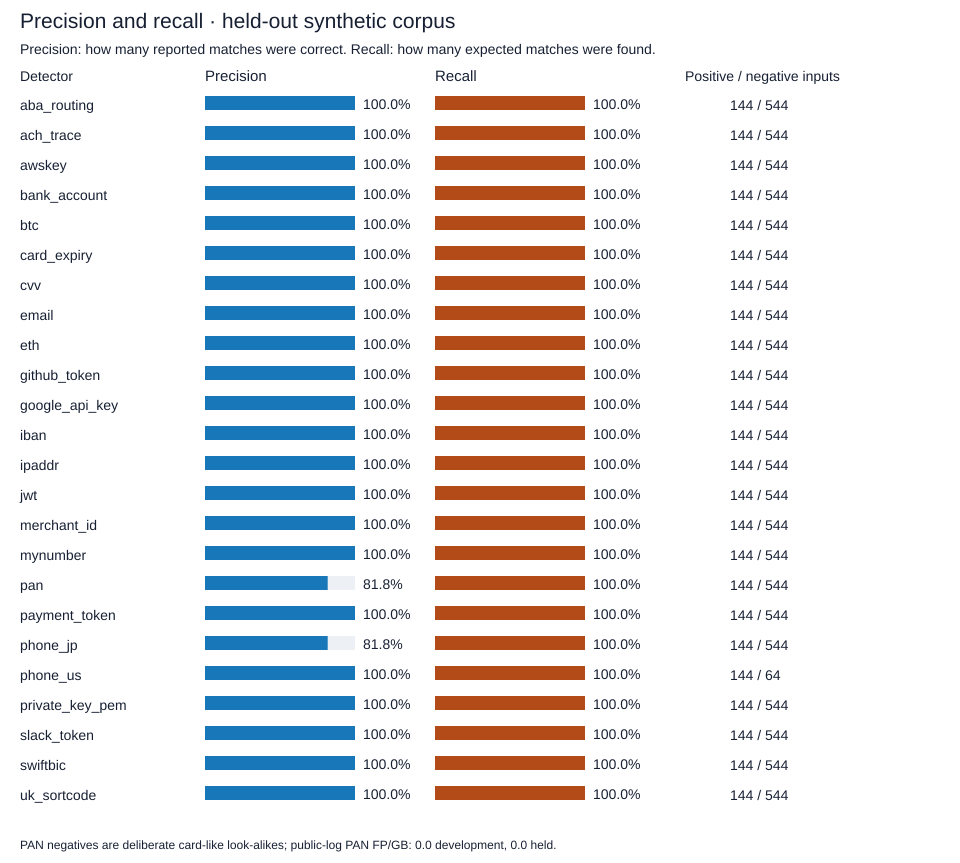
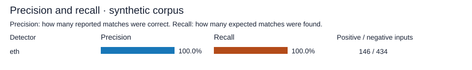
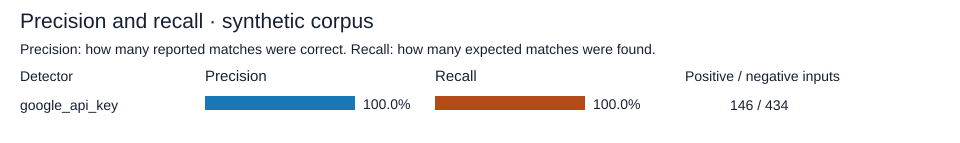
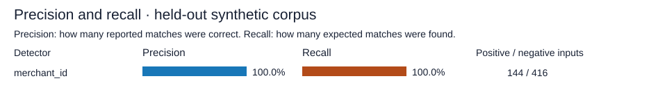
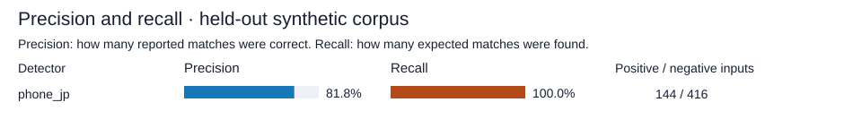

# Synthetic accuracy corpus

## Conditions

This corpus contains 13,340 detector/input evaluations. It is generated offline with Python `random.Random(20261115)` and contains no production observations. Repeated surroundings reuse values, so sample counts are not independent statistical trials.

The [generator](../scripts/generate_accuracy.py) constructs values and byte ranges without invoking embargo. Each detector receives 146 positive inputs and 434 negative inputs: two hand-written positives plus 24 values in six surroundings, and hand-written, generated and shared negative controls. CI checks the generated fixtures, scores, figures and this page for drift.

Surroundings include logs, JSON, URLs, line endings and Japanese text, with full-width digits and separators for supported numeric families. Negative controls include UUIDs, Git SHAs, hashes, timestamps, order/invoice identifiers, base64 without a JWT header, versions and phone-shaped serial numbers. Detector-specific negatives include bad checksums, invalid prefixes, short credentials and invalid months.

A hit requires an unused expected range with the same detector kind and exact original byte positions. Partial, duplicate and extra matches are false positives; an unmatched expected range is a false negative. Precision is TP/(TP+FP), and recall is TP/(TP+FN).

Each detector runs alone at the default confidence threshold. URL-encoded positives remain labeled sensitive even where the scanner cannot decode them. This deliberately exposes misses instead of redefining the expected answer.

The samples cover only the listed format variants. They do not establish account existence, credential validity or behavior on other encodings.

[Scoring tests](../tests/accuracy_test.go) cover partial, wrong-kind and duplicate matches. [Regression tests](../tests/accuracy_regression_test.go) reject new mismatches and obsolete exceptions. The reviewed [limit list](../tests/testdata/accuracy_limits.jsonl) records each mismatch and its reason; the first expanded run failed before those limits were documented.

## Results



| Detector | Positive / negative inputs | TP / FP / FN spans | Precision | Recall |
|---|---:|---:|---:|---:|
| [aba_routing](#aba-routing) | 146 / 434 | 146 / 0 / 0 | 100.0% | 100.0% |
| [ach_trace](#ach-trace) | 146 / 434 | 146 / 0 / 0 | 100.0% | 100.0% |
| [awskey](#awskey) | 146 / 434 | 146 / 0 / 0 | 100.0% | 100.0% |
| [bank_account](#bank-account) | 146 / 434 | 122 / 0 / 24 | 100.0% | 83.6% |
| [btc](#btc) | 146 / 434 | 146 / 0 / 0 | 100.0% | 100.0% |
| [card_expiry](#card-expiry) | 146 / 434 | 122 / 0 / 24 | 100.0% | 83.6% |
| [cvv](#cvv) | 146 / 434 | 146 / 0 / 0 | 100.0% | 100.0% |
| [email](#email) | 146 / 434 | 122 / 24 / 24 | 83.6% | 83.6% |
| [eth](#eth) | 146 / 434 | 146 / 0 / 0 | 100.0% | 100.0% |
| [github_token](#github-token) | 146 / 434 | 146 / 0 / 0 | 100.0% | 100.0% |
| [google_api_key](#google-api-key) | 146 / 434 | 146 / 0 / 0 | 100.0% | 100.0% |
| [iban](#iban) | 146 / 434 | 146 / 0 / 0 | 100.0% | 100.0% |
| [ipaddr](#ipaddr) | 146 / 434 | 146 / 0 / 0 | 100.0% | 100.0% |
| [jwt](#jwt) | 146 / 434 | 146 / 0 / 0 | 100.0% | 100.0% |
| [merchant_id](#merchant-id) | 146 / 434 | 122 / 0 / 24 | 100.0% | 83.6% |
| [mynumber](#mynumber) | 146 / 434 | 138 / 33 / 8 | 80.7% | 94.5% |
| [pan](#pan) | 146 / 434 | 138 / 97 / 8 | 58.7% | 94.5% |
| [payment_token](#payment-token) | 146 / 434 | 146 / 0 / 0 | 100.0% | 100.0% |
| [phone_jp](#phone-jp) | 146 / 434 | 138 / 32 / 8 | 81.2% | 94.5% |
| [private_key_pem](#private-key-pem) | 146 / 434 | 122 / 0 / 24 | 100.0% | 83.6% |
| [slack_token](#slack-token) | 146 / 434 | 146 / 0 / 0 | 100.0% | 100.0% |
| [swiftbic](#swiftbic) | 146 / 434 | 146 / 120 / 0 | 54.9% | 100.0% |
| [uk_sortcode](#uk-sortcode) | 146 / 434 | 145 / 0 / 1 | 100.0% | 99.3% |

## aba routing


Verified by the [aba_routing format tests](../internal/detect/aba_test.go) and the [corpus regression check](../tests/accuracy_regression_test.go). Independently generated routing checksums, line endings and checksum failures.

No misses or false alarms appeared in these samples.

[Inspect generated inputs and original byte ranges](../tests/testdata/accuracy_generated.jsonl).

## ach trace


Verified by the [ach_trace format tests](../internal/detect/ach_test.go) and the [corpus regression check](../tests/accuracy_regression_test.go). Contextual fifteen-digit traces, line endings and short traces as negatives.

No misses or false alarms appeared in these samples.

[Inspect generated inputs and original byte ranges](../tests/testdata/accuracy_generated.jsonl).

## awskey


Verified by the [awskey format tests](../internal/detect/awskey_test.go) and the [corpus regression check](../tests/accuracy_regression_test.go). AKIA and ASIA prefixes in log, JSON and Japanese text; short tokens as negatives.

No misses or false alarms appeared in these samples.

[Inspect generated inputs and original byte ranges](../tests/testdata/accuracy_generated.jsonl).

## bank account


Verified by the [bank_account format tests](../internal/detect/bank_account_test.go) and the [corpus regression check](../tests/accuracy_regression_test.go). Contextual account numbers in log, JSON and Japanese text; too-short values as negatives.

| Observed limit | Input example | Why it remains |
|---|---|---|
| `bank_account/positive/0/url` | `value=bank%20account%2018393904` | Percent decoding is not a general scanner contract: encoded digits, separators or context words can be missed or matched only in part. Decode the application field before scanning. |

[Inspect generated inputs and original byte ranges](../tests/testdata/accuracy_generated.jsonl).

## btc


Verified by the [btc format tests](../internal/detect/btc_test.go) and the [corpus regression check](../tests/accuracy_regression_test.go). Independently generated Base58Check P2PKH addresses and invalid checksum look-alikes.

No misses or false alarms appeared in these samples.

[Inspect generated inputs and original byte ranges](../tests/testdata/accuracy_generated.jsonl).

## card expiry


Verified by the [card_expiry format tests](../internal/detect/card_expiry_test.go) and the [corpus regression check](../tests/accuracy_regression_test.go). Month/year dates near expiry context in log, JSON and Japanese text; invalid months as negatives.

| Observed limit | Input example | Why it remains |
|---|---|---|
| `card_expiry/positive/0/url` | `value=expiry%2001%2F28` | Percent decoding is not a general scanner contract: encoded digits, separators or context words can be missed or matched only in part. Decode the application field before scanning. |

[Inspect generated inputs and original byte ranges](../tests/testdata/accuracy_generated.jsonl).

## cvv


Verified by the [cvv format tests](../internal/detect/cvv_test.go) and the [corpus regression check](../tests/accuracy_regression_test.go). Three-digit values near CVV context in log, JSON and Japanese text; two-digit values as negatives.

No misses or false alarms appeared in these samples.

[Inspect generated inputs and original byte ranges](../tests/testdata/accuracy_generated.jsonl).

## email


Verified by the [email format tests](../internal/detect/email_test.go) and the [corpus regression check](../tests/accuracy_regression_test.go). Plus-addressing, JSON fields, Japanese boundaries and doubled-at-sign negatives.

| Observed limit | Input example | Why it remains |
|---|---|---|
| `email/positive/0/url` | `value=user.0%2Bfixture@example.com` | Percent decoding is not a general scanner contract: encoded digits, separators or context words can be missed or matched only in part. Decode the application field before scanning. |

[Inspect generated inputs and original byte ranges](../tests/testdata/accuracy_generated.jsonl).

## eth



Verified by the [eth format tests](../internal/detect/eth_test.go) and the [corpus regression check](../tests/accuracy_regression_test.go). Lowercase hexadecimal addresses and malformed non-hexadecimal look-alikes.

No misses or false alarms appeared in these samples.

[Inspect generated inputs and original byte ranges](../tests/testdata/accuracy_generated.jsonl).

## github token


Verified by the [github_token format tests](../internal/detect/github_token_test.go) and the [corpus regression check](../tests/accuracy_regression_test.go). Four classic token prefixes in log, JSON and Japanese text; short tokens as negatives.

No misses or false alarms appeared in these samples.

[Inspect generated inputs and original byte ranges](../tests/testdata/accuracy_generated.jsonl).

## google api key



Verified by the [google_api_key format tests](../internal/detect/google_apikey_test.go) and the [corpus regression check](../tests/accuracy_regression_test.go). AIza-prefixed keys in log, JSON and Japanese text; short bodies as negatives.

No misses or false alarms appeared in these samples.

[Inspect generated inputs and original byte ranges](../tests/testdata/accuracy_generated.jsonl).

## iban


Verified by the [iban format tests](../internal/detect/iban_test.go) and the [corpus regression check](../tests/accuracy_regression_test.go). Independently generated German MOD 97 check digits and surrounding JSON or log text.

No misses or false alarms appeared in these samples.

[Inspect generated inputs and original byte ranges](../tests/testdata/accuracy_generated.jsonl).

## ipaddr


Verified by the [ipaddr format tests](../internal/detect/ipaddr_test.go) and the [corpus regression check](../tests/accuracy_regression_test.go). Documentation-range IPv4 and IPv6 addresses, Japanese boundaries and invalid octets.

No misses or false alarms appeared in these samples.

[Inspect generated inputs and original byte ranges](../tests/testdata/accuracy_generated.jsonl).

## jwt


Verified by the [jwt format tests](../internal/detect/jwt_test.go) and the [corpus regression check](../tests/accuracy_regression_test.go). Base64url header, payload and signature fields; malformed payload look-alikes.

No misses or false alarms appeared in these samples.

[Inspect generated inputs and original byte ranges](../tests/testdata/accuracy_generated.jsonl).

## merchant id



Verified by the [merchant_id format tests](../internal/detect/merchant_id_test.go) and the [corpus regression check](../tests/accuracy_regression_test.go). Contextual merchant IDs in log, JSON and Japanese text; short IDs as negatives.

| Observed limit | Input example | Why it remains |
|---|---|---|
| `merchant_id/positive/0/url` | `value=merchant%20ID%20ZNFBVPHU2BHHFXP` | Percent decoding is not a general scanner contract: encoded digits, separators or context words can be missed or matched only in part. Decode the application field before scanning. |

[Inspect generated inputs and original byte ranges](../tests/testdata/accuracy_generated.jsonl).

## mynumber


Verified by the [mynumber format tests](../internal/detect/mynumber_test.go) and the [corpus regression check](../tests/accuracy_regression_test.go). Independently generated MOD 11 check digits, full-width digits and Japanese text boundaries.

| Observed limit | Input example | Why it remains |
|---|---|---|
| `mynumber/control/invoice/0` | `Invoice: 100042543904` | Numeric shapes do not establish intent: synthetic order/invoice identifiers can satisfy financial or identity formats; no business-context classifier is implemented. |
| `mynumber/hand-control/3836757899a21400855fd9348f29bdf993ae1ab030af419e1da21cf369256503` | `Shipment ID: 123456789018` | Business identifiers can share valid sensitive-number shapes and checksums; their intended meaning is not recoverable from this text alone. |
| `mynumber/positive/11/url` | `value=%EF%BC%94%EF%BC%91%EF%BC%92%EF%BC%…%98%EF%BC%91` | Percent decoding is not a general scanner contract: encoded digits, separators or context words can be missed or matched only in part. Decode the application field before scanning. |

[Inspect generated inputs and original byte ranges](../tests/testdata/accuracy_generated.jsonl).

## pan


Verified by the [pan format tests](../internal/detect/pan_test.go) and the [corpus regression check](../tests/accuracy_regression_test.go). Luhn-valid Visa, Mastercard, Amex and JCB shapes, hyphen-separated groups and full-width digits.

| Observed limit | Input example | Why it remains |
|---|---|---|
| `pan/control/order/0` | `Order ID: 4763270889822167` | Numeric shapes do not establish intent: synthetic order/invoice identifiers can satisfy financial or identity formats; no business-context classifier is implemented. |
| `pan/hand-control/01ef18b4b7eb0e54db6141d48ce1cdf84370d86e40f77cdfe2461e1f7366bd46` | `Order ID: 4532015112830366` | Business identifiers can share valid sensitive-number shapes and checksums; their intended meaning is not recoverable from this text alone. |
| `pan/negative/0/japanese` | `処理結果【card-like 4033438821713084】を記録しました` | PAN deliberately returns BIN/length candidates with a failing Luhn checksum at lower confidence; default confidence accepts them. |
| `pan/positive/11/url` | `value=%EF%BC%93%EF%BC%95%EF%BC%92%EF%BC%…%98%EF%BC%95` | Percent decoding is not a general scanner contract: encoded digits, separators or context words can be missed or matched only in part. Decode the application field before scanning. |

[Inspect generated inputs and original byte ranges](../tests/testdata/accuracy_generated.jsonl).

## payment token


Verified by the [payment_token format tests](../internal/detect/payment_token_test.go) and the [corpus regression check](../tests/accuracy_regression_test.go). Five payment-token prefixes in log, JSON and Japanese text; short bodies as negatives.

No misses or false alarms appeared in these samples.

[Inspect generated inputs and original byte ranges](../tests/testdata/accuracy_generated.jsonl).

## phone jp



Verified by the [phone_jp format tests](../internal/detect/phone_jp_test.go) and the [corpus regression check](../tests/accuracy_regression_test.go). Hyphenated mobile numbers, full-width digits and Japanese text boundaries.

| Observed limit | Input example | Why it remains |
|---|---|---|
| `phone_jp/control/phone-shaped serial/0` | `Serial: 090-1000-2000` | A serial number with a valid Japanese mobile-number shape is indistinguishable from a phone number without application context. This format detector does not infer the business meaning of a serial field. |
| `phone_jp/positive/11/url` | `value=%EF%BC%90%EF%BC%99%EF%BC%90%EF%BC%…%92%EF%BC%90` | Percent decoding is not a general scanner contract: encoded digits, separators or context words can be missed or matched only in part. Decode the application field before scanning. |

[Inspect generated inputs and original byte ranges](../tests/testdata/accuracy_generated.jsonl).

## private key pem


Verified by the [private_key_pem format tests](../internal/detect/private_key_pem_test.go) and the [corpus regression check](../tests/accuracy_regression_test.go). RSA, EC, OpenSSH and PKCS#8 private-key headers; public-key and certificate headers as negatives.

| Observed limit | Input example | Why it remains |
|---|---|---|
| `private_key_pem/positive/0/url` | `value=-----BEGIN%20RSA%20PRIVATE%20KEY-----` | Percent decoding is not a general scanner contract: encoded digits, separators or context words can be missed or matched only in part. Decode the application field before scanning. |

[Inspect generated inputs and original byte ranges](../tests/testdata/accuracy_generated.jsonl).

## slack token


Verified by the [slack_token format tests](../internal/detect/slack_token_test.go) and the [corpus regression check](../tests/accuracy_regression_test.go). Multi-part xoxb shapes in log, JSON and Japanese text; an unsupported type letter as a negative.

No misses or false alarms appeared in these samples.

[Inspect generated inputs and original byte ranges](../tests/testdata/accuracy_generated.jsonl).

## swiftbic


Verified by the [swiftbic format tests](../internal/detect/swiftbic_test.go) and the [corpus regression check](../tests/accuracy_regression_test.go). Eight- and eleven-character shapes near SWIFT context, with invalid country-code look-alikes.

| Observed limit | Input example | Why it remains |
|---|---|---|
| `swiftbic/positive/0/json` | `{"message":"SWIFT: TESTGBIK","result":"accepted"}` | The nearby SWIFT keyword permits alphabetic BIC shapes; ordinary words such as accepted or finished can satisfy the format. Institution assignment is not checked. |

[Inspect generated inputs and original byte ranges](../tests/testdata/accuracy_generated.jsonl).

## uk sortcode


Verified by the [uk_sortcode format tests](../internal/detect/sortcode_test.go) and the [corpus regression check](../tests/accuracy_regression_test.go). Separated sort codes, context words, and overlong sequences as negatives.

| Observed limit | Input example | Why it remains |
|---|---|---|
| `uk_sortcode/positive/11/url` | `value=sort%20code%3A%2012-05-46` | Percent decoding is not a general scanner contract: encoded digits, separators or context words can be missed or matched only in part. Decode the application field before scanning. |

[Inspect generated inputs and original byte ranges](../tests/testdata/accuracy_generated.jsonl).

## Regeneration

```sh
make accuracy-doc
python3 scripts/generate_accuracy.py --check
python3 scripts/accuracy_figures.py --check
go -C tests test -run "Test(Accuracy|GeneratedAccuracy)" .
```

PEM fixtures test headers rather than complete private keys. Generated service tokens test syntax, not authentication; generated identity and phone values must not be used for contacting people or transactions.

[Support maintenance](https://github.com/sponsors/nao1215).
