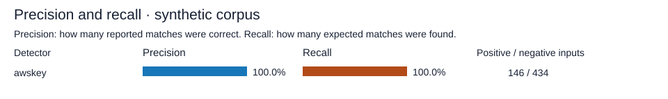
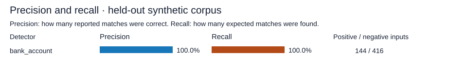
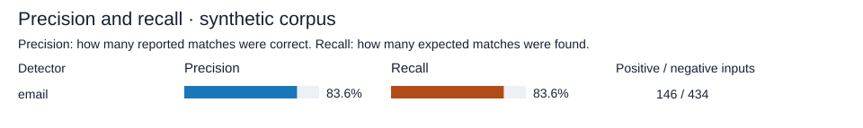
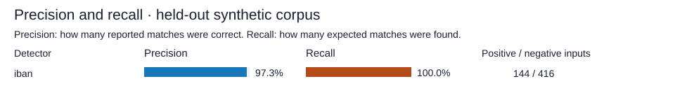
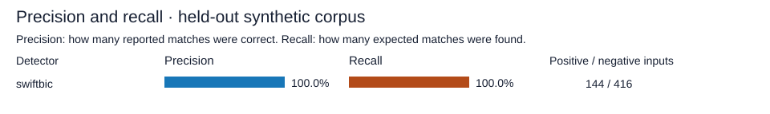

# Synthetic accuracy corpus

## Conditions

The development set uses Python `random.Random(20261115)`; the held-out set uses `random.Random(20270129)` and six different surrounding templates. Both were fixed before detector changes. Only development failures informed tuning; the held-out evaluation rejected a stricter SWIFT context rule because it reduced recall. We treated this as overfitting and reverted the rule; no held-out failure was used to tune the retained changes.

Development contains 13,340 evaluations; held-out contains 12,880. The [generator](../scripts/generate_accuracy.py) constructs values and original byte ranges without invoking embargo. Development includes hand-written controls; held-out includes only independently generated values and controls. Repeated surroundings reuse values, and deterministic format examples such as email names and date cycles occur in both sets. Counts are not independent statistical trials. This is synthetic evaluation, not evidence of production accuracy or credential validity.

Surroundings include logs, JSON, URLs, line endings and Japanese text. Negative controls include hashes, UUIDs, timestamps, order/invoice/tracking identifiers, versions, invalid checksums and malformed credentials. Labels and templates are not a substitute for a real-world corpus.

A hit requires the same kind and exact unused original byte range. Partial, duplicate and extra matches count as false positives; missing expected ranges count as false negatives. Precision is TP/(TP+FP); recall is TP/(TP+FN). Each detector runs alone.

The default minimum confidence remains 0: ambiguous candidates are included. Confidence is a heuristic, not a probability. PAN checksum failures score 0.6; PAN, My Number and Japanese phone candidates with an attached order, invoice, tracking, version, build, serial or shipment label score 0.4. `WithMinConfidence(0.7)` excludes these candidates and can therefore miss genuine secrets under misleading business labels. A global 0.7 threshold also removes the 0.5–0.65 bank-account findings and some sort-code findings; it is not a universal accuracy setting. Both policies are measured below; the README chart uses held-out results at the default threshold.

## Encoding policy

Built-in detectors decode exactly one layer of valid `%HH` escapes anywhere in the input before detection. Findings map back to original bytes, so masking covers the escaped representation. Literal `+` and malformed percent escapes remain unchanged. Custom detectors receive the original bytes. Base64, hexadecimal, HTML entities, JSON escapes and recursively percent-encoded forms are not decoded by Scanner; decode application fields explicitly when needed. The logger adapters separately decode JSON strings at their output boundary.

[Round-trip and offset properties](../scanner_encoding_test.go) exercise random partial escaping and all byte values. [Regression tests](../tests/accuracy_regression_test.go) reject new mismatches and obsolete exceptions in both sets. Known limits retain reasons in [development](../tests/testdata/accuracy_limits.jsonl) and [held-out](../tests/testdata/accuracy_held_limits.jsonl) fixtures.

## Held-out results: default threshold 0


| Detector | Positive / negative inputs | TP / FP / FN spans | Precision | Recall |
|---|---:|---:|---:|---:|
| [aba_routing](#aba-routing) | 144 / 416 | 144 / 0 / 0 | 100.0% | 100.0% |
| [ach_trace](#ach-trace) | 144 / 416 | 144 / 0 / 0 | 100.0% | 100.0% |
| [awskey](#awskey) | 144 / 416 | 144 / 0 / 0 | 100.0% | 100.0% |
| [bank_account](#bank-account) | 144 / 416 | 144 / 0 / 0 | 100.0% | 100.0% |
| [btc](#btc) | 144 / 416 | 144 / 0 / 0 | 100.0% | 100.0% |
| [card_expiry](#card-expiry) | 144 / 416 | 144 / 0 / 0 | 100.0% | 100.0% |
| [cvv](#cvv) | 144 / 416 | 144 / 0 / 0 | 100.0% | 100.0% |
| [email](#email) | 144 / 416 | 144 / 0 / 0 | 100.0% | 100.0% |
| [eth](#eth) | 144 / 416 | 144 / 0 / 0 | 100.0% | 100.0% |
| [github_token](#github-token) | 144 / 416 | 144 / 0 / 0 | 100.0% | 100.0% |
| [google_api_key](#google-api-key) | 144 / 416 | 144 / 0 / 0 | 100.0% | 100.0% |
| [iban](#iban) | 144 / 416 | 144 / 4 / 0 | 97.3% | 100.0% |
| [ipaddr](#ipaddr) | 144 / 416 | 144 / 0 / 0 | 100.0% | 100.0% |
| [jwt](#jwt) | 144 / 416 | 144 / 0 / 0 | 100.0% | 100.0% |
| [merchant_id](#merchant-id) | 144 / 416 | 144 / 0 / 0 | 100.0% | 100.0% |
| [mynumber](#mynumber) | 144 / 416 | 144 / 32 / 0 | 81.8% | 100.0% |
| [pan](#pan) | 144 / 416 | 144 / 96 / 0 | 60.0% | 100.0% |
| [payment_token](#payment-token) | 144 / 416 | 144 / 0 / 0 | 100.0% | 100.0% |
| [phone_jp](#phone-jp) | 144 / 416 | 144 / 32 / 0 | 81.8% | 100.0% |
| [private_key_pem](#private-key-pem) | 144 / 416 | 144 / 0 / 0 | 100.0% | 100.0% |
| [slack_token](#slack-token) | 144 / 416 | 144 / 0 / 0 | 100.0% | 100.0% |
| [swiftbic](#swiftbic) | 144 / 416 | 144 / 0 / 0 | 100.0% | 100.0% |
| [uk_sortcode](#uk-sortcode) | 144 / 416 | 144 / 0 / 0 | 100.0% | 100.0% |

## Development results: default threshold 0

| Detector | Positive / negative inputs | TP / FP / FN spans | Precision | Recall |
|---|---:|---:|---:|---:|
| [aba_routing](#aba-routing) | 146 / 434 | 146 / 0 / 0 | 100.0% | 100.0% |
| [ach_trace](#ach-trace) | 146 / 434 | 146 / 0 / 0 | 100.0% | 100.0% |
| [awskey](#awskey) | 146 / 434 | 146 / 0 / 0 | 100.0% | 100.0% |
| [bank_account](#bank-account) | 146 / 434 | 146 / 0 / 0 | 100.0% | 100.0% |
| [btc](#btc) | 146 / 434 | 146 / 0 / 0 | 100.0% | 100.0% |
| [card_expiry](#card-expiry) | 146 / 434 | 146 / 0 / 0 | 100.0% | 100.0% |
| [cvv](#cvv) | 146 / 434 | 146 / 0 / 0 | 100.0% | 100.0% |
| [email](#email) | 146 / 434 | 146 / 0 / 0 | 100.0% | 100.0% |
| [eth](#eth) | 146 / 434 | 146 / 0 / 0 | 100.0% | 100.0% |
| [github_token](#github-token) | 146 / 434 | 146 / 0 / 0 | 100.0% | 100.0% |
| [google_api_key](#google-api-key) | 146 / 434 | 146 / 0 / 0 | 100.0% | 100.0% |
| [iban](#iban) | 146 / 434 | 146 / 0 / 0 | 100.0% | 100.0% |
| [ipaddr](#ipaddr) | 146 / 434 | 146 / 0 / 0 | 100.0% | 100.0% |
| [jwt](#jwt) | 146 / 434 | 146 / 0 / 0 | 100.0% | 100.0% |
| [merchant_id](#merchant-id) | 146 / 434 | 146 / 0 / 0 | 100.0% | 100.0% |
| [mynumber](#mynumber) | 146 / 434 | 146 / 33 / 0 | 81.6% | 100.0% |
| [pan](#pan) | 146 / 434 | 146 / 97 / 0 | 60.1% | 100.0% |
| [payment_token](#payment-token) | 146 / 434 | 146 / 0 / 0 | 100.0% | 100.0% |
| [phone_jp](#phone-jp) | 146 / 434 | 146 / 32 / 0 | 82.0% | 100.0% |
| [private_key_pem](#private-key-pem) | 146 / 434 | 146 / 0 / 0 | 100.0% | 100.0% |
| [slack_token](#slack-token) | 146 / 434 | 146 / 0 / 0 | 100.0% | 100.0% |
| [swiftbic](#swiftbic) | 146 / 434 | 146 / 120 / 0 | 54.9% | 100.0% |
| [uk_sortcode](#uk-sortcode) | 146 / 434 | 146 / 0 / 0 | 100.0% | 100.0% |

## Held-out results: minimum confidence 0.7

| Detector | Positive / negative inputs | TP / FP / FN spans | Precision | Recall |
|---|---:|---:|---:|---:|
| [aba_routing](#aba-routing) | 144 / 416 | 144 / 0 / 0 | 100.0% | 100.0% |
| [ach_trace](#ach-trace) | 144 / 416 | 144 / 0 / 0 | 100.0% | 100.0% |
| [awskey](#awskey) | 144 / 416 | 144 / 0 / 0 | 100.0% | 100.0% |
| [bank_account](#bank-account) | 144 / 416 | 0 / 0 / 144 | n/a | 0.0% |
| [btc](#btc) | 144 / 416 | 144 / 0 / 0 | 100.0% | 100.0% |
| [card_expiry](#card-expiry) | 144 / 416 | 144 / 0 / 0 | 100.0% | 100.0% |
| [cvv](#cvv) | 144 / 416 | 144 / 0 / 0 | 100.0% | 100.0% |
| [email](#email) | 144 / 416 | 144 / 0 / 0 | 100.0% | 100.0% |
| [eth](#eth) | 144 / 416 | 144 / 0 / 0 | 100.0% | 100.0% |
| [github_token](#github-token) | 144 / 416 | 144 / 0 / 0 | 100.0% | 100.0% |
| [google_api_key](#google-api-key) | 144 / 416 | 144 / 0 / 0 | 100.0% | 100.0% |
| [iban](#iban) | 144 / 416 | 144 / 4 / 0 | 97.3% | 100.0% |
| [ipaddr](#ipaddr) | 144 / 416 | 144 / 0 / 0 | 100.0% | 100.0% |
| [jwt](#jwt) | 144 / 416 | 144 / 0 / 0 | 100.0% | 100.0% |
| [merchant_id](#merchant-id) | 144 / 416 | 144 / 0 / 0 | 100.0% | 100.0% |
| [mynumber](#mynumber) | 144 / 416 | 144 / 0 / 0 | 100.0% | 100.0% |
| [pan](#pan) | 144 / 416 | 144 / 0 / 0 | 100.0% | 100.0% |
| [payment_token](#payment-token) | 144 / 416 | 144 / 0 / 0 | 100.0% | 100.0% |
| [phone_jp](#phone-jp) | 144 / 416 | 144 / 0 / 0 | 100.0% | 100.0% |
| [private_key_pem](#private-key-pem) | 144 / 416 | 144 / 0 / 0 | 100.0% | 100.0% |
| [slack_token](#slack-token) | 144 / 416 | 144 / 0 / 0 | 100.0% | 100.0% |
| [swiftbic](#swiftbic) | 144 / 416 | 144 / 0 / 0 | 100.0% | 100.0% |
| [uk_sortcode](#uk-sortcode) | 144 / 416 | 138 / 0 / 6 | 100.0% | 95.8% |

## Development results: minimum confidence 0.7

| Detector | Positive / negative inputs | TP / FP / FN spans | Precision | Recall |
|---|---:|---:|---:|---:|
| [aba_routing](#aba-routing) | 146 / 434 | 146 / 0 / 0 | 100.0% | 100.0% |
| [ach_trace](#ach-trace) | 146 / 434 | 146 / 0 / 0 | 100.0% | 100.0% |
| [awskey](#awskey) | 146 / 434 | 146 / 0 / 0 | 100.0% | 100.0% |
| [bank_account](#bank-account) | 146 / 434 | 0 / 0 / 146 | n/a | 0.0% |
| [btc](#btc) | 146 / 434 | 146 / 0 / 0 | 100.0% | 100.0% |
| [card_expiry](#card-expiry) | 146 / 434 | 146 / 0 / 0 | 100.0% | 100.0% |
| [cvv](#cvv) | 146 / 434 | 146 / 0 / 0 | 100.0% | 100.0% |
| [email](#email) | 146 / 434 | 146 / 0 / 0 | 100.0% | 100.0% |
| [eth](#eth) | 146 / 434 | 146 / 0 / 0 | 100.0% | 100.0% |
| [github_token](#github-token) | 146 / 434 | 146 / 0 / 0 | 100.0% | 100.0% |
| [google_api_key](#google-api-key) | 146 / 434 | 146 / 0 / 0 | 100.0% | 100.0% |
| [iban](#iban) | 146 / 434 | 146 / 0 / 0 | 100.0% | 100.0% |
| [ipaddr](#ipaddr) | 146 / 434 | 146 / 0 / 0 | 100.0% | 100.0% |
| [jwt](#jwt) | 146 / 434 | 146 / 0 / 0 | 100.0% | 100.0% |
| [merchant_id](#merchant-id) | 146 / 434 | 146 / 0 / 0 | 100.0% | 100.0% |
| [mynumber](#mynumber) | 146 / 434 | 146 / 0 / 0 | 100.0% | 100.0% |
| [pan](#pan) | 146 / 434 | 146 / 0 / 0 | 100.0% | 100.0% |
| [payment_token](#payment-token) | 146 / 434 | 146 / 0 / 0 | 100.0% | 100.0% |
| [phone_jp](#phone-jp) | 146 / 434 | 146 / 0 / 0 | 100.0% | 100.0% |
| [private_key_pem](#private-key-pem) | 146 / 434 | 146 / 0 / 0 | 100.0% | 100.0% |
| [slack_token](#slack-token) | 146 / 434 | 146 / 0 / 0 | 100.0% | 100.0% |
| [swiftbic](#swiftbic) | 146 / 434 | 146 / 120 / 0 | 54.9% | 100.0% |
| [uk_sortcode](#uk-sortcode) | 146 / 434 | 140 / 0 / 6 | 100.0% | 95.9% |

## aba routing


Verified by the [aba_routing format tests](../internal/detect/aba_test.go) and the [corpus regression check](../tests/accuracy_regression_test.go). Independently generated routing checksums, line endings and checksum failures.

No misses or false alarms appeared in either set.

## ach trace


Verified by the [ach_trace format tests](../internal/detect/ach_test.go) and the [corpus regression check](../tests/accuracy_regression_test.go). Contextual fifteen-digit traces, line endings and short traces as negatives.

No misses or false alarms appeared in either set.

## awskey



Verified by the [awskey format tests](../internal/detect/awskey_test.go) and the [corpus regression check](../tests/accuracy_regression_test.go). AKIA and ASIA prefixes in log, JSON and Japanese text; short tokens as negatives.

No misses or false alarms appeared in either set.

## bank account



Verified by the [bank_account format tests](../internal/detect/bank_account_test.go) and the [corpus regression check](../tests/accuracy_regression_test.go). Contextual account numbers in log, JSON and Japanese text; too-short values as negatives.

No misses or false alarms appeared in either set.

## btc


Verified by the [btc format tests](../internal/detect/btc_test.go) and the [corpus regression check](../tests/accuracy_regression_test.go). Independently generated Base58Check P2PKH addresses and invalid checksum look-alikes.

No misses or false alarms appeared in either set.

## card expiry


Verified by the [card_expiry format tests](../internal/detect/card_expiry_test.go) and the [corpus regression check](../tests/accuracy_regression_test.go). Month/year dates near expiry context in log, JSON and Japanese text; invalid months as negatives.

No misses or false alarms appeared in either set.

## cvv


Verified by the [cvv format tests](../internal/detect/cvv_test.go) and the [corpus regression check](../tests/accuracy_regression_test.go). Three-digit values near CVV context in log, JSON and Japanese text; two-digit values as negatives.

No misses or false alarms appeared in either set.

## email



Verified by the [email format tests](../internal/detect/email_test.go) and the [corpus regression check](../tests/accuracy_regression_test.go). Plus-addressing, JSON fields, Japanese boundaries and doubled-at-sign negatives.

No misses or false alarms appeared in either set.

## eth


Verified by the [eth format tests](../internal/detect/eth_test.go) and the [corpus regression check](../tests/accuracy_regression_test.go). Lowercase hexadecimal addresses and malformed non-hexadecimal look-alikes.

No misses or false alarms appeared in either set.

## github token


Verified by the [github_token format tests](../internal/detect/github_token_test.go) and the [corpus regression check](../tests/accuracy_regression_test.go). Four classic token prefixes in log, JSON and Japanese text; short tokens as negatives.

No misses or false alarms appeared in either set.

## google api key


Verified by the [google_api_key format tests](../internal/detect/google_apikey_test.go) and the [corpus regression check](../tests/accuracy_regression_test.go). AIza-prefixed keys in log, JSON and Japanese text; short bodies as negatives.

No misses or false alarms appeared in either set.

## iban



Verified by the [iban format tests](../internal/detect/iban_test.go) and the [corpus regression check](../tests/accuracy_regression_test.go). Independently generated German MOD 97 check digits and surrounding JSON or log text.

| Set / observed limit | Input example | Why it remains |
|---|---|---|
| held-out: `iban/negative/9/japanese` | `入力〈DE00278095005992016380〉確認済み` | MOD 97 alone accepts some synthetic IBANs whose check digits are 00; check-digit range validation remains a held-out discovery and was not used for tuning. |

## ipaddr


Verified by the [ipaddr format tests](../internal/detect/ipaddr_test.go) and the [corpus regression check](../tests/accuracy_regression_test.go). Documentation-range IPv4 and IPv6 addresses, Japanese boundaries and invalid octets.

No misses or false alarms appeared in either set.

## jwt


Verified by the [jwt format tests](../internal/detect/jwt_test.go) and the [corpus regression check](../tests/accuracy_regression_test.go). Base64url header, payload and signature fields; malformed payload look-alikes.

No misses or false alarms appeared in either set.

## merchant id


Verified by the [merchant_id format tests](../internal/detect/merchant_id_test.go) and the [corpus regression check](../tests/accuracy_regression_test.go). Contextual merchant IDs in log, JSON and Japanese text; short IDs as negatives.

No misses or false alarms appeared in either set.

## mynumber


Verified by the [mynumber format tests](../internal/detect/mynumber_test.go) and the [corpus regression check](../tests/accuracy_regression_test.go). Independently generated MOD 11 check digits, full-width digits and Japanese text boundaries.

| Set / observed limit | Input example | Why it remains |
|---|---|---|
| development: `mynumber/control/invoice/0` | `Invoice: 100042543904` | Business identifiers can satisfy sensitive-number shapes and checksums. Attached business labels lower confidence to 0.4, but the default threshold of 0 preserves ambiguous candidates. |

## pan


Verified by the [pan format tests](../internal/detect/pan_test.go) and the [corpus regression check](../tests/accuracy_regression_test.go). Luhn-valid Visa, Mastercard, Amex and JCB shapes, hyphen-separated groups and full-width digits.

| Set / observed limit | Input example | Why it remains |
|---|---|---|
| development: `pan/control/order/0` | `Order ID: 4763270889822167` | Business identifiers can satisfy sensitive-number shapes and checksums. Attached business labels lower confidence to 0.4, but the default threshold of 0 preserves ambiguous candidates. |
| development: `pan/negative/0/japanese` | `処理結果【card-like 4033438821713084】を記録しました` | PAN deliberately returns BIN/length candidates with a failing Luhn checksum at lower confidence; default confidence accepts them. |

## payment token


Verified by the [payment_token format tests](../internal/detect/payment_token_test.go) and the [corpus regression check](../tests/accuracy_regression_test.go). Five payment-token prefixes in log, JSON and Japanese text; short bodies as negatives.

No misses or false alarms appeared in either set.

## phone jp


Verified by the [phone_jp format tests](../internal/detect/phone_jp_test.go) and the [corpus regression check](../tests/accuracy_regression_test.go). Hyphenated mobile numbers, full-width digits and Japanese text boundaries.

| Set / observed limit | Input example | Why it remains |
|---|---|---|
| development: `phone_jp/control/phone-shaped serial/0` | `Serial: 090-1000-2000` | Business identifiers can satisfy sensitive-number shapes and checksums. Attached business labels lower confidence to 0.4, but the default threshold of 0 preserves ambiguous candidates. |

## private key pem


Verified by the [private_key_pem format tests](../internal/detect/private_key_pem_test.go) and the [corpus regression check](../tests/accuracy_regression_test.go). RSA, EC, OpenSSH and PKCS#8 private-key headers; public-key and certificate headers as negatives.

No misses or false alarms appeared in either set.

## slack token


Verified by the [slack_token format tests](../internal/detect/slack_token_test.go) and the [corpus regression check](../tests/accuracy_regression_test.go). Multi-part xoxb shapes in log, JSON and Japanese text; an unsupported type letter as a negative.

No misses or false alarms appeared in either set.

## swiftbic



Verified by the [swiftbic format tests](../internal/detect/swiftbic_test.go) and the [corpus regression check](../tests/accuracy_regression_test.go). Eight- and eleven-character shapes near SWIFT context, with invalid country-code look-alikes.

| Set / observed limit | Input example | Why it remains |
|---|---|---|
| development: `swiftbic/positive/0/json` | `{"message":"SWIFT: TESTGBIK","result":"accepted"}` | The nearby SWIFT keyword permits alphabetic BIC shapes; ordinary words such as accepted or finished can satisfy the format. Institution assignment is not checked. |

## uk sortcode


Verified by the [uk_sortcode format tests](../internal/detect/sortcode_test.go) and the [corpus regression check](../tests/accuracy_regression_test.go). Separated sort codes, context words, and overlong sequences as negatives.

No misses or false alarms appeared in either set.

## Regeneration

```sh
make accuracy-doc
python3 scripts/generate_accuracy.py --check
python3 scripts/accuracy_figures.py --check
go -C tests test -run "Test(Accuracy|GeneratedAccuracy)" .
```

The 0.7 results improve PAN, My Number and phone precision on both sets without losing recall in these samples; the default retains their ambiguous business identifiers. Email and encoded-form recall improve on both sets. SWIFT word false positives remain: the rejected attachment rule improved development precision but failed held-out evaluation. A held-out IBAN with check digits 00 passed MOD 97; that discovery remains a documented limit for a future development set.

PEM samples test headers, not full private keys. Generated service tokens test syntax, not authentication. Do not use synthetic identities, account or phone values for transactions or contacting people.

[Support maintenance](https://github.com/sponsors/nao1215).
