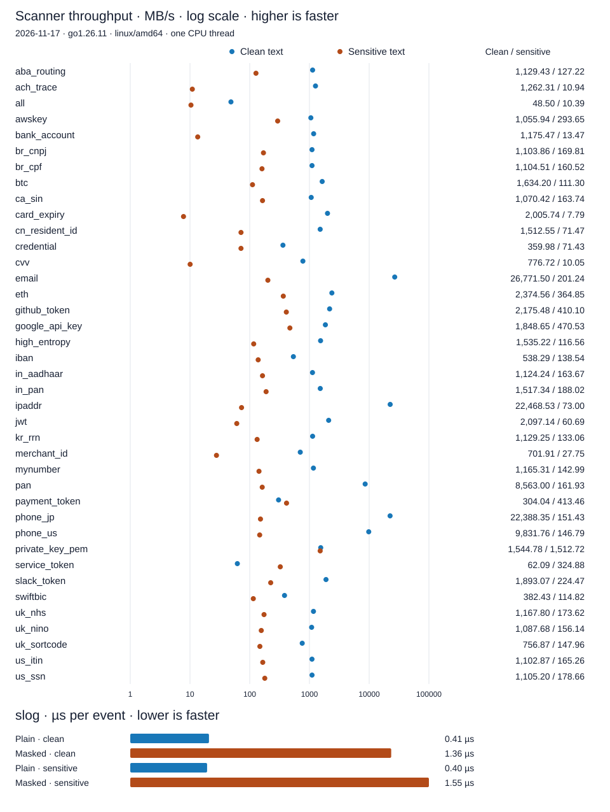

# Benchmarks

Run `make benchmark-doc` on an idle machine. It uses Go 1.26.11, GOMAXPROCS=1 and ten 200 ms samples, stores every sample in benchmarks.raw.txt and the medians with machine/source metadata in benchmarks.json, then regenerates the full benchmark plot and this page’s tables. Scanner benchmarks cover clean text and each detector's synthetic positive fixture, plus WithAll over all positive fixtures. Mask uses precomputed findings. Recorder includes creation, a writer, an expectation, Check and testing cleanup registration. The slog comparison uses a real JSONHandler and a counting sink, so encoding work is present in both the plain and wrapped measurements.

Shared CI runners have variable load. CI compiles benchmarks and checks the table against its recorded samples; it does not impose a noisy wall-time threshold. Compare base and head manually on the same idle machine and retain both outputs; the comparison should alternate runs to reduce time-order bias:

```sh
git worktree add ../embargo-benchmark-base "$(git merge-base HEAD origin/main)"
GOMAXPROCS=1 GOTOOLCHAIN=go1.26.11 go -C ../embargo-benchmark-base/tests test -run '^$' -bench '^BenchmarkPublished' -benchmem -count=10 . > base.txt
GOMAXPROCS=1 GOTOOLCHAIN=go1.26.11 go -C tests test -run '^$' -bench '^BenchmarkPublished' -benchmem -count=10 . > head.txt
go run golang.org/x/perf/cmd/benchstat@v0.0.0-20261009192801-be2c69fb417e base.txt head.txt
```

Use a base that contains these benchmark names and a compatible API. The first benchmark publication has no comparable base for the newly introduced recorder and slog wrapper. Keep timing differences separate from allocations and throughput, and inspect confidence intervals before drawing conclusions.



## Measured results

<!-- benchmarks:start -->
Measured 2026-11-17 with go1.26.11, linux/amd64, AMD RYZEN AI MAX+ 395 w/ Radeon 8060S, GOMAXPROCS=1; median of ten 200 ms samples.

Background load: no intentional concurrent workload.

| Operation | ns/op | MB/s | B/op | allocs/op |
|---|---:|---:|---:|---:|
| Scanner WithAll, clean | 64694.5 | 42.54 | 0 | 0 |
| Scanner WithAll, dirty | 6927204.0 | 9.18 | 1431824 | 11824 |
| Mask | 3317.5 | 887.66 | 8448 | 2 |
| Writer only | 5.7 | 94907.39 | 0 | 0 |
| Recorder + Check | 50541.0 | 10.76 | 45900 | 686 |
| Plain slog, clean | 430.0 | — | 16 | 1 |
| Masked slog, clean | 1453.5 | — | 16 | 1 |
| Plain slog, dirty | 424.1 | — | 16 | 1 |
| Masked slog, dirty | 1738.0 | — | 64 | 2 |

<details>
<summary>Per-detector Scanner throughput</summary>

| Detector | Clean MB/s | Dirty MB/s |
|---|---:|---:|
| aba_routing | 884.43 | 119.20 |
| ach_trace | 937.54 | 9.71 |
| all | 42.54 | 9.18 |
| awskey | 1069.07 | 265.07 |
| bank_account | 906.08 | 12.93 |
| br_cnpj | 874.26 | 161.18 |
| br_cpf | 867.84 | 161.83 |
| btc | 1206.04 | 103.44 |
| ca_sin | 857.37 | 155.72 |
| card_expiry | 1385.98 | 7.70 |
| cn_resident_id | 1101.72 | 69.85 |
| credential | 362.55 | 71.31 |
| cvv | 642.57 | 9.82 |
| email | 4182.23 | 181.48 |
| eth | 1525.26 | 318.53 |
| github_token | 1454.76 | 359.96 |
| google_api_key | 1298.53 | 412.38 |
| high_entropy | 1216.20 | 110.26 |
| iban | 434.47 | 127.07 |
| in_aadhaar | 881.13 | 156.55 |
| in_pan | 1115.72 | 183.28 |
| ipaddr | 4014.06 | 70.69 |
| jwt | 1426.62 | 58.28 |
| kr_rrn | 886.89 | 130.75 |
| merchant_id | 588.03 | 27.05 |
| mynumber | 991.82 | 115.86 |
| pan | 3110.60 | 150.54 |
| payment_token | 273.13 | 351.73 |
| phone_jp | 3912.62 | 121.97 |
| phone_us | 3131.45 | 119.07 |
| private_key_pem | 1114.80 | 1138.87 |
| service_token | 430.77 | 443.19 |
| slack_token | 1256.15 | 188.98 |
| swiftbic | 352.22 | 109.35 |
| uk_nhs | 914.43 | 164.74 |
| uk_nino | 859.23 | 151.24 |
| uk_sortcode | 619.88 | 137.25 |
| us_itin | 864.94 | 166.93 |
| us_ssn | 864.40 | 166.54 |

</details>
<!-- benchmarks:end -->

## Candidate windows and dispatch

Production scanning uses hint dispatch and validates complete candidate boundaries. The test-only candidate-window prototype in scanner_dispatch_test.go cannot bound arbitrary credential values or PEM bodies: long assignments, PEM bodies and provider tokens cross its fixed windows. TestCandidateExperimentGate checks exact kinds, offsets, confidence and order against the production scanner and retains those disqualifying cases. Run it with EMBARGO_LOG_CACHE pointing to the checksum-pinned corpus to include real log lines. No timing improvement is claimed for the prototype.

Reuse Scanner across events to amortize immutable dispatch construction. Percent-encoded inputs need a decoded buffer and an original-position map; ordinary inputs avoid those buffers. Single-detector scans retain substring selection, while multi-detector scans use hint buckets.

## Choose the kinds the application needs

WithKinds avoids running irrelevant detectors and removes their false-positive findings. The following measurements use identical input for all selections: 2,752 bytes of clean worker text and 39,552 bytes containing every detector's synthetic positive fixture. They measure scanning only, not logger encoding. The clean fixture has no @, so email-only scanning exits after a substring check; its ratio should not be extrapolated to arbitrary logs.

<!-- narrowing:start -->
| Selection | Clean ns/op | Dirty ns/op | Clean / dirty speedup over WithAll |
|---|---:|---:|---|
| all | 60,274.000 | 6,487,012.0 | 1.00× / 1.00× |
| kinds1 | 96.955 | 38,425.5 | 621.67× / 168.82× |
| kinds3 | 14,700.500 | 598,465.0 | 4.10× / 10.84× |
| kinds8 | 17,402.000 | 2,790,511.5 | 3.46× / 2.32× |
<!-- narrowing:end -->

The one-kind set is email; three kinds add PAN and credential; eight add Japanese phone, IP address, GitHub token, service token and private-key PEM. Omitting kinds gives up their recall. Select kinds according to the application's output policy and inspect the [real-log false-positive estimates](accuracy.md#public-system-logs).

These dated samples ran ten times with alternating kind order, Go 1.26.11 and GOMAXPROCS=1 on one host. They describe that recorded fixture and implementation, not the current release's universal performance. [Raw samples](performance/scanner-narrowing.raw.txt) retain the variation. Run `make scanner-experiment CPU=8` on an idle Linux machine to refresh the samples; `python3 scripts/scanner_experiment.py --check` only checks the committed table.
