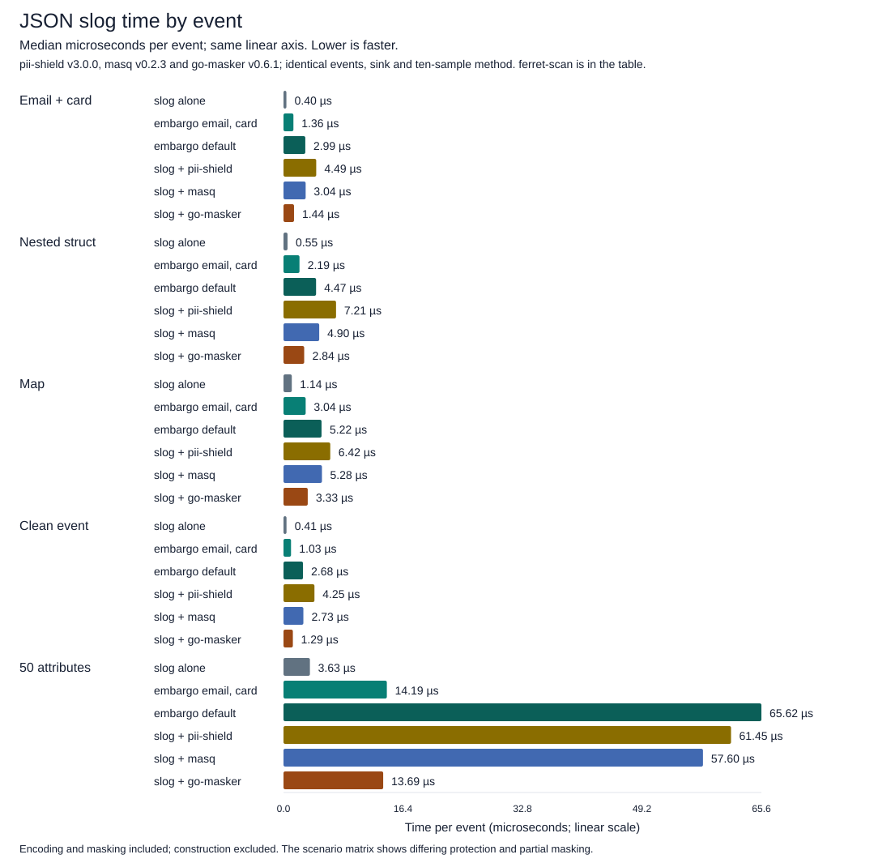
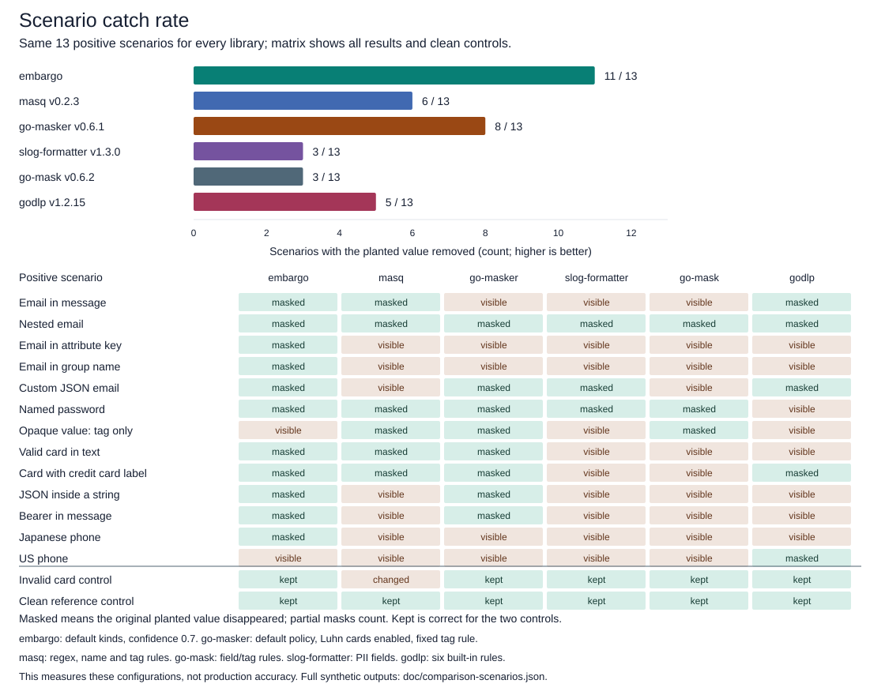

# Measured application masking comparison

This compares overlapping use cases, not overall library quality or adoption. pii-shield v3.0.0 (default policy plus the recovery key, fixed salt) and ferret-scan v2.4.3 (Simple strategy; every check in the scenario and leak tables, EMAIL and CREDIT_CARD in the timings) rewrite each encoded slog line before the sink, the position their documentation gives for in-process use; pii-shield also runs as a sidecar and ferret-scan scans files, which are not measured here. Each library is the newest release that builds with the library's minimum Go 1.26.11; for ferret-scan that is v2.4.3, because v2.4.4 and later require Go 1.27. masq v0.2.3 offers a convenient slog ReplaceAttr, type/tag/name/prefix rules, allowed types and custom censors/redactors. embargo adds built-in detection, output-safe values, multiple logger adapters and application output assertions. The exact measured production and benchmark source fingerprint is recorded with the results.

## Keeping a known secret out: typed wrappers

embargo `Secret` and ggwhite/go-masker v3.3.0 `Sensitive` are the two typed wrappers among the measured libraries. The test renders one wrapped password through each standard output path; hidden means the value is absent from the output, and error means the encoder refused the type. go-masker's `Sensitive` also offers partial-display maskers and database `Scan`/`Value`, which this table does not score.

<!-- secret-types:start -->
| Output path | embargo Secret | ggwhite/go-masker v3.3.0 Sensitive |
|---|---|---|
| `fmt` `%v` and `%s` | hidden | hidden |
| `fmt` `%+v` of a struct field | hidden | hidden |
| `fmt` `%+v` of an unexported field | hidden | visible |
| `fmt` `%#v` | hidden | hidden |
| `fmt` `%x` and `%q` | hidden | hidden |
| error built with `fmt.Errorf` | hidden | hidden |
| `encoding/json` struct field | hidden | hidden |
| `encoding/xml` struct field | hidden | hidden |
| `encoding/gob` struct field | error | error |
| `text/template` value | hidden | hidden |
| `slog` JSON attribute | hidden | hidden |
| `slog` text attribute | hidden | hidden |
<!-- secret-types:end -->

## Correctness before speed

The first eight cases reproduce the original comparison probe. Both libraries receive identical events through slog.JSONHandler. masq gets precompiled email and 13–19 digit card regexes, Password/password/token field rules and `masq:"secret"`, with time.Time and slog.Level allowed; embargo selects email/PAN detectors, default confidence 0 and its default sensitive keys plus `recovery`. The tagged Recovery field is protected by that key rule in embargo. These are practical documented configurations; neither claims that regex syntax provides a checksum validator.

<!-- correctness:start -->
| Case | masq v0.2.3 output fragment | embargo output fragment |
|---|---|---|
| nested_struct | `"user":{"ID":"u123","Email":"[REDACTED]"}` | `"user":{"ID":"u123","Email":"[REDACTED]"}` |
| message | `"msg":"[REDACTED]"` | `"msg":"login failed for [REDACTED]"` |
| attribute_key | `"alice@example.com":"ok"` | `"[REDACTED]":"ok"` |
| group_name | `"alice@example.com":{"status":"ok"}` | `"[REDACTED]":{"status":"ok"}` |
| marshal_json | `"email":"alice@example.com"` | `"email":"[REDACTED]"` |
| wrapped_error | `"error":"[REDACTED]"` | `"error":"request failed: [REDACTED]"` |
| opaque_password | `"Password":"[REDACTED]"` | `"Password":"[REDACTED]"` |
| secret_wrapper | `"Password":"[REDACTED]"` | `"Password":"[REDACTED]"` |
| tag_or_key | `"Recovery":"[REDACTED]"` | `"Recovery":"[REDACTED]"` |
| valid_card | `"card":"[REDACTED]"` | `"card":"[REDACTED]"` |
| invalid_luhn | `"order":"[REDACTED]"` | `"order":"4111111111111112"` |
| map | `"data":{"count":17,"email":null,"password":null}` | `"data":{"count":17,"email":"[REDACTED]","password":"[REDACTED]"}` |
<!-- correctness:end -->

masq requires user rules to find the email and card; plain `masq.New()` does not detect them. Its standard redactor removes an entire matched message/error string; embargo keeps the surrounding context. masq can use RedactString for partial replacement or a custom censor for validation. With this configuration it leaves attribute keys, group names and custom MarshalJSON-generated data visible. Both retain struct shape; masq v0.2.3 replaces matching interface-valued map entries with null in this fixture, while embargo uses a string marker. These are observed version-specific outputs, not claims that all masq configurations behave identically.

The invalid-Luhn row is a deliberate negative example. embargo keeps it, because KindPAN rejects every number that fails the Luhn check. go-masker with its opt-in Luhn check keeps the invalid-card control too, while masq changes it; the matrix displays these costs beside positive catches. The [accuracy corpus](accuracy.md) covers broader detector tradeoffs; these small fixtures are not a production accuracy estimate.

## Time and allocations

<!-- comparison:start -->
| Benchmark | ns/op | B/op | allocs/op |
|---|---:|---:|---:|
| Comparison/clean/embargo | 945.0 | 0 | 0 |
| Comparison/clean/embargo-default | 1,380.5 | 0 | 0 |
| Comparison/clean/ferret-scan | 86,111.0 | 7,208 | 83 |
| Comparison/clean/go-masker | 1,366.0 | 8 | 1 |
| Comparison/clean/masq | 2,816.0 | 792 | 50 |
| Comparison/clean/pii-shield | 4,490.5 | 488 | 4 |
| Comparison/clean/plain | 420.3 | 0 | 0 |
| Comparison/flat/embargo | 1,301.5 | 0 | 0 |
| Comparison/flat/embargo-default | 2,105.5 | 0 | 0 |
| Comparison/flat/ferret-scan | 120,069.0 | 53,556 | 385 |
| Comparison/flat/go-masker | 1,419.0 | 48 | 3 |
| Comparison/flat/masq | 3,129.5 | 672 | 32 |
| Comparison/flat/pii-shield | 4,805.0 | 702 | 11 |
| Comparison/flat/plain | 406.6 | 0 | 0 |
| Comparison/large50/embargo | 13,106.5 | 4,098 | 2 |
| Comparison/large50/embargo-default | 21,517.5 | 4,100 | 2 |
| Comparison/large50/ferret-scan | 1,015,559.0 | 71,011 | 386 |
| Comparison/large50/go-masker | 13,963.5 | 2,096 | 4 |
| Comparison/large50/masq | 60,439.0 | 12,707 | 561 |
| Comparison/large50/pii-shield | 66,222.0 | 8,369 | 12 |
| Comparison/large50/plain | 3,805.5 | 2,048 | 1 |
| Comparison/map/embargo | 3,050.0 | 554 | 15 |
| Comparison/map/embargo-default | 4,109.0 | 554 | 15 |
| Comparison/map/ferret-scan | 142,140.0 | 54,137 | 391 |
| Comparison/map/go-masker | 3,503.0 | 1,448 | 29 |
| Comparison/map/masq | 5,537.0 | 1,744 | 63 |
| Comparison/map/pii-shield | 6,950.5 | 1,184 | 22 |
| Comparison/map/plain | 1,232.0 | 288 | 9 |
| Comparison/nested/embargo | 2,390.0 | 282 | 5 |
| Comparison/nested/embargo-default | 2,860.0 | 282 | 5 |
| Comparison/nested/ferret-scan | 150,387.5 | 47,608 | 264 |
| Comparison/nested/go-masker | 2,964.5 | 800 | 19 |
| Comparison/nested/masq | 5,153.0 | 1,784 | 61 |
| Comparison/nested/pii-shield | 7,757.5 | 960 | 18 |
| Comparison/nested/plain | 582.2 | 0 | 0 |
| ComparisonFormatter/clean | 552.4 | 0 | 0 |
| ComparisonFormatter/flat | 616.8 | 32 | 2 |
| ComparisonFormatter/large50 | 7,598.5 | 7,872 | 10 |
| ComparisonFormatter/map | 451.0 | 0 | 0 |
| ComparisonFormatter/nested | 451.1 | 0 | 0 |
| ComparisonStruct/embargo | 1,613.5 | 338 | 5 |
| ComparisonStruct/go_mask | 569.3 | 328 | 7 |
| ComparisonText/embargo | 2,062.5 | 880 | 12 |
| ComparisonText/godlp | 30,275.0 | 11,713 | 59 |
| StructuredPath/json_shape | 1,611.0 | 338 | 5 |
| StructuredPath/old_string | 643.3 | 576 | 7 |

Measured 2026-11-18 with go version go1.26.11 linux/amd64, Linux/amd64, AMD RYZEN AI MAX+ 395 w/ Radeon 8060S; GOMAXPROCS=1, ten 200 ms samples per case. Construction is outside the timed loop; JSON encoding and masking are included. Source and dependency fingerprints, CPU affinity and command are in [comparison.json](comparison.json).

Each library is timed against an embargo configuration of similar detection breadth. masq and go-masker are given email and card rules and ferret-scan is narrowed to its EMAIL and CREDIT_CARD checks, so `embargo` selects KindEmail and KindPAN. pii-shield cannot turn its built-in detectors off, so `embargo-default` runs the default scanner against it. The scenario and leak tables use ferret-scan with every check. For these five configured events, from the median times, embargo is 1.07 to 1.45 times faster than go-masker, 1.82 to 4.61 times faster than masq and 47 to 92 times faster than ferret-scan; embargo-default is 1.69 to 3.25 times faster than pii-shield. The default scanner takes 1.20 to 1.64 times as long as the email-and-card configuration, and the structured JSON path takes 2.50 times as long as the old string-only path. These factors are regenerated from the same samples as the table.
<!-- comparison:end -->

The five head-to-head events are a flat email/card pair, a nested struct with opaque password and tagged recovery field, a map, a clean event, and 50 attributes (48 clean plus the flat pair). All four paths use the same io.Discard sink. masq uses its documented WithAllowedType for time.Time and slog.Level, matching embargo's decision to preserve that metadata; this avoids charging masq for an unnecessary reflection traversal. Masker/scanner construction and regex compilation are excluded for every path. The tests use prebuilt slog.Attr slices and LogAttrs to avoid attributing caller argument construction to any library.

The generated ratios describe these configured events. Raw samples and confidence intervals matter more than a single rounded speedup. They do not predict tag-only or type-only masq policies, other payloads or machines.

[Raw ten-sample output](comparison.raw.txt), [benchstat comparison including significance, B/op and allocs/op](comparison.benchstat.txt), [benchmark source and correctness assertions](../tests/comparison_test.go).

`StructuredPath/old_string` measures the former encode-then-scan-string work. It is cheaper, but does not preserve structured output or enforce opaque key rules. `StructuredPath/json_shape` includes decoding and walking the encoded values; it preserves JSON semantics and checks the key policy. This extra cost is real. Profiling the initial Decoder.Token implementation attributed about 41% of sampled CPU time to that traversal; validating with encoding/json.Valid and walking the bytes reduced allocations while retaining duplicate keys, JSON string decoding and number precision. There is no reflection walk of scalar attributes or Go objects in embargo; encoding/json performs its usual encoding work.

Run `make comparison-doc` to rerun ten samples, benchstat and all generated comparison artifacts. `python3 scripts/comparison_docs.py --check` and the tests module's TestComparisonDocuments reject stale source fingerprints, evidence, tables or chart. The make target needs Go 1.26.11, Python 3 and benchstat on PATH. Measurements are local CPU results, not promises for other machines, payloads, policies or custom detectors.

## Other overlapping libraries

[Exact outputs for the same events and text fixtures](comparison-libraries.md) are regenerated and asserted by [comparison_test.go](../tests/comparison_test.go). The additional timing rows measure different contracts and must not be interpreted as equivalent protection. PIIFormatter and go-mask are faster on their measured tasks: they apply configured field transformations without embargo's text detection, and PIIFormatter removes the nested Any object. godlp is slower on the text fixture but supports phone families embargo does not.

| Library and version | Configuration and useful differences |
|---|---|
| [samber/slog-formatter v1.3.0](https://github.com/samber/slog-formatter/tree/v1.3.0) | [Explanation 1](#table-explanation-1) |
| [bytedance/godlp v1.2.15](https://github.com/bytedance/godlp/tree/v1.2.15) | [Explanation 2](#table-explanation-2) |
| [showa-93/go-mask v0.6.2](https://github.com/showa-93/go-mask/tree/v0.6.2) | [Explanation 3](#table-explanation-3) |
| [icntswm/go-masker v0.6.1](https://github.com/icntswm/go-masker/tree/v0.6.1) | [Shared scenarios and setup](#shared-scenarios-and-setup) |

## Remaining use cases

embargo cannot automatically identify arbitrary unregistered secrets; use Secret, a key rule or a custom detector. It does not return a typed masked struct copy, apply partial display per field (WithMaskFunc chooses it per kind), preserve safe/unsafe provenance, or centrally enforce OTel pipelines. JSON response/export masking is covered by MaskJSON when the boundary accepts JSON bytes; callers that need a typed copy for further business logic still benefit from struct-copy libraries. Non-JSON formats, encoded binary data, unsupported phone/identity families, custom method side effects and data added downstream need separate handling and output tests. URL/DSN credentials, additional token detectors and package-wide output checks are covered by the credential and output scenario suite below. An error-wrapping helper is intentionally absent because preserving Unwrap also exposes the original error text.

[Fields without tags and database/config inputs](values.md), [shared logging semantics](logging.md), [keep an existing masker and test its real output](testing-output.md), [security scan decisions](security-scans.md).

[Support maintenance](https://github.com/sponsors/nao1215).

## Service leak scenarios

The runnable `scenarioService` handles HTTP requests using a database DSN, an opaque password, a synthetic third-party token, wrapped and joined errors, and either slog or zap. The comparison configures masq's documented field rules and email/PAN regexes, slog-formatter's documented FormatByKey rules for password/token, and go-mask's registered field masks. No library receives an oracle containing the planted values. Users can extend all of these configurations; this measures the listed configurations, not every possible custom rule. go-mask processes attribute containers before logging; message text is outside that field policy. Redirect responses bypass every logger, so an output guard remains necessary.

<!-- leak-scenarios:start -->
| Service output | embargo slog | embargo zap | pii-shield v3.0.0 | ferret-scan v2.4.3 | masq v0.2.3 | slog-formatter v1.3.0 | go-mask v0.6.2 | go-masker v0.6.1 | godlp v1.2.15 |
|---|---|---|---|---|---|---|---|---|---|
| Password under the key `password` | caught | caught | caught | caught | caught | caught | caught | caught | leaked |
| Config struct holding a database DSN | caught | caught | caught | leaked | caught | leaked | leaked | caught | leaked |
| DSN inside a wrapped error | caught | caught | caught | leaked | caught | leaked | leaked | caught | leaked |
| DSN and an API key joined with errors.Join | caught | caught | caught | leaked | leaked | leaked | leaked | caught | leaked |
| Bearer header value in a log message | caught | caught | caught | leaked | leaked | leaked | leaked | caught | leaked |
| Third-party API key in a log message | caught | caught | caught | leaked | leaked | leaked | leaked | leaked | leaked |
| Redirect URL query, never logged | leaked | leaked | leaked | leaked | leaked | leaked | leaked | leaked | leaked |
<!-- leak-scenarios:end -->

Run `make leak-scenarios` to regenerate this table. `TestLeakScenarios` checks it for staleness, and `TestLeakScenarioGuard` verifies that a real recorder rejects the planted logs and accepts the masked slog and zap variants. Caught means the entire planted value disappeared from the observed output; it does not imply arbitrary secrets are detected. SDK serialization and unrelated output paths require their own checks.

The staleness check fingerprints embargo production code, comparison tests, the Go/toolchain directives and the compared libraries with their reached module dependencies. An unrelated SDK bump, such as Sentry, no longer invalidates timing evidence. `comparison.json` also keeps `full_source_sha256`, including complete tests/go.mod and tests/go.sum, so the original environment remains auditable. When a compared library changes, recheck its dependency closure with `go list -deps` and remeasure; changing its code paths still invalidates the comparison.

## Table explanations

PIIFormatter for email/card/user/data/password/token; preserves a four-character prefix of long strings, preserves ID fields in slog groups, and replaces Any objects with a marker rather than preserving their nested JSON fields. The same five events are measured.

Embedded documented rules 1/2/6/16/20/35 for phone/email/card/IP; no rewritten detector regexes. It masks email/card partially, detects but deliberately does not mask IP under its default IP rule, and handles US phones but not the Japanese phone family. The table shows both Japanese and US fixtures.

Documented fixed string masker plus field registration for Email/Password/Recovery/email/password/card; same event payloads and nested struct. It returns a Go value copy suitable for callers that need that type, rather than encoded JSON.

## Shared scenarios and setup

All eight libraries run the same 13 positive scenarios and two clean controls. The [full synthetic outputs](comparison-scenarios.json) record their exact released versions. The fixtures include a case outside embargo's capabilities: an opaque secret marked only by a struct tag. A catch means the original planted value is absent from a nonempty JSON log event; partial masks count, and absence does not imply complete redaction. The catch rate is for these configurations and scenarios, not production accuracy. The clean controls are excluded from its denominator.

| Library | Setup used by the executable probe | Measured strengths and limits |
|---|---|---|
| embargo | Default kinds, default confidence 0, slog wrapper | 12/13; masks keys, groups and both phone families; misses the tag-only secret |
| pii-shield v3.0.0 | Default policy plus one recovery key, applied to each encoded line | 10/13; masks message text and both phone families; attribute keys, the bearer header and the tag-only secret remain |
| ferret-scan v2.4.3 | In-process engine with its default checks, applied to each encoded line | 9/13; masks keys and groups; embedded JSON, the bearer header, the Japanese phone and the tag-only secret remain |
| masq v0.2.3 | Two regexes, three field names, one tag; time/level allowed | 6/13; tag-only protection wins; whole-string redaction loses context |
| go-masker v0.6.1 | Default key policy, Luhn cards, safe types, fixed tag rule | 8/13; tags win and embedded JSON ties; partial display by default |
| slog-formatter v1.3.0 | PIIFormatter on six sensitive field names | 3/13; fixed field transforms are cheaper; arbitrary message text remains |
| go-mask v0.6.2 | Fixed masker, six registered fields and a fixed struct tag | 3/13; tags win and typed copies aid reuse; message text remains |
| godlp v1.2.15 | Six built-in rules; apply to string and JSON values | 5/13; US phone ties; email/labeled-card partial masking ties; opaque tokens remain |

The labeled and unlabeled card rows expose a context difference: godlp detects the credit-card-labeled message in this fixture, while the unlabeled charge message remains visible. These setup counts describe this harness, not universal effort. No configuration contains the planted secret values. The timing event selects only email and PAN at default confidence 0 for embargo; the scenario matrix uses the default detector set and default confidence 0. The invalid-card control therefore changes, as it does for a new user. go-masker uses its default policy with opt-in Luhn card detection, so the invalid-card control stays visible; its CardRule keeps the last four digits. Its value inspection recognizes credentials inside JSON strings and free text. Its key policies and struct tags offer partial display rules that embargo lacks. TestComparisonMaskerAdapters runs its slog, zap, zerolog and HTTP paths against synthetic credentials; HTTP masks copies of headers and URLs, rather than installing an access logger.

Runtime dependency counts are measured with `go list -deps`, excluding the library's own module and the standard library, and recorded in comparison.json. embargo, masq, go-mask and go-masker have zero external runtime modules on these paths; masq and go-mask declare test dependencies that do not enter an application's binary. slog-formatter reaches four external runtime modules and godlp one. This distinction replaces counts of all go.mod requirements, which unfairly charged test dependencies to consumers.

The four bars in the [time-per-event chart](images/log-event-time.svg) use exactly the same prebuilt request/email/card event, JSONHandler, sink and ten-sample method. The slog-alone bar measures the encoding cost before masking. Compare absolute microseconds and allocations in the full table: faster field transformations and partial redaction perform different work from a detector scan. Build and setup costs are outside the timed loop for every library.
