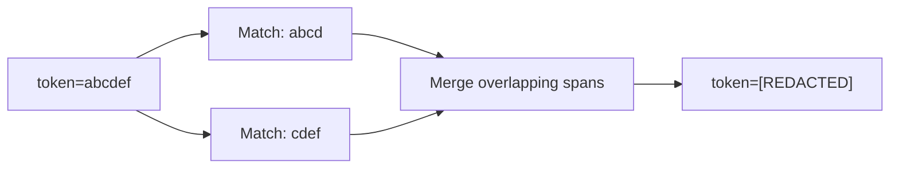

# Scanning and masking

`Scan` accepts bytes, `ScanString` accepts text, and `ScanLines` handles independent lines. Findings contain the kind, confidence, and start/end byte positions in the original input. `WithKinds` selects detectors; omitting options enables 26 built-ins at minimum confidence 0, including ambiguous candidates. The 11 national ID kinds and KindHighEntropy are opt-in; `WithAll` selects all 38 built-ins. Built-ins decode one layer of valid percent escapes and map findings back to the original bytes; custom detectors receive the original input. Literal plus signs, malformed escapes and other encodings remain unchanged.

## Overlapping matches

Two detectors can describe overlapping parts of one value. `Mask` replaces their combined range once, so the end of either match cannot escape redaction.

<!-- overlap:start -->

<!-- overlap:end -->

The diagram comes from the [runnable overlap Example](../example_test.go). `make masking-doc` regenerates it and the README before/after table; ordinary tests reject differences.

`MaskFunc` receives the original text of each merged range and chooses its replacement. The highest-confidence finding supplies the kind; ties sort by kind, start, then descending end. Adjacent ranges remain separate; invalid ranges redact the entire input without calling the callback.

See [Mask and MaskFunc Examples](../example_test.go), [overlap tests](../tests/properties_test.go), and [custom detector contracts](../scanner_test.go).

## Custom detection

Implement `Detector.Scan` and pass it to `WithDetector` for an application-specific pattern. Return nonempty ranges within the input and finite confidence values between zero and one. The scanner checks these contracts; custom detectors must leave input unchanged and support concurrent calls when shared.

## Choosing a policy

Confidence is a format heuristic, not a probability that a value is sensitive. For example, a card number under an order or invoice label is a lower-confidence candidate. `WithMinConfidence(0.7)` excludes business-labeled numeric candidates, including real secrets under misleading labels; it also drops lower-scored bank accounts and some sort codes. Review the [synthetic accuracy cases](accuracy.md) before selecting a threshold or allowing fixture values.

[Support maintenance](https://github.com/sponsors/nao1215).
