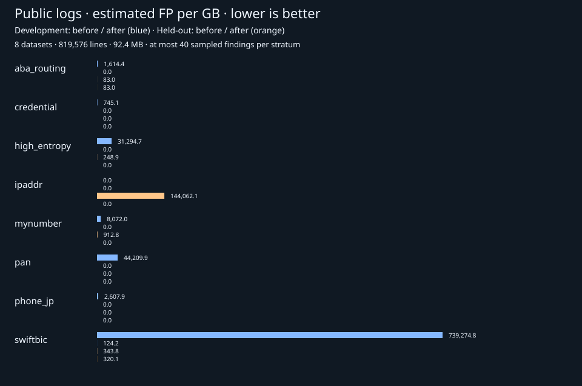

## Public system logs

<!-- real-logs:start -->
| Dataset | Split | Scope | Bytes | Lines | License / source |
|---|---|---|---:|---:|---|
| Android | development | official 2,000-line sample | 279,076 | 2,000 | [LogHub research/academic use](https://github.com/logpai/loghub/blob/dd61d0952749ee7963bde24220d1be5ede023033/LICENSE); [provenance](https://github.com/logpai/loghub/blob/dd61d0952749ee7963bde24220d1be5ede023033/Android/README.md) |
| Apache | development | complete | 5,135,876 | 56,482 | [LogHub research/academic use](https://github.com/logpai/loghub/blob/dd61d0952749ee7963bde24220d1be5ede023033/LICENSE); [provenance](https://github.com/logpai/loghub/blob/dd61d0952749ee7963bde24220d1be5ede023033/Apache/README.md) |
| BGL | held | official 2,000-line sample | 317,150 | 2,000 | [LogHub research/academic use](https://github.com/logpai/loghub/blob/dd61d0952749ee7963bde24220d1be5ede023033/LICENSE); [provenance](https://github.com/logpai/loghub/blob/dd61d0952749ee7963bde24220d1be5ede023033/BGL/README.md) |
| HDFS | development | official 2,000-line sample | 287,848 | 2,000 | [LogHub research/academic use](https://github.com/logpai/loghub/blob/dd61d0952749ee7963bde24220d1be5ede023033/LICENSE); [provenance](https://github.com/logpai/loghub/blob/dd61d0952749ee7963bde24220d1be5ede023033/HDFS/README.md) |
| Linux | development | complete | 2,349,686 | 25,567 | [LogHub research/academic use](https://github.com/logpai/loghub/blob/dd61d0952749ee7963bde24220d1be5ede023033/LICENSE); [provenance](https://github.com/logpai/loghub/blob/dd61d0952749ee7963bde24220d1be5ede023033/Linux/README.md) |
| OpenSSH | held | complete | 73,417,506 | 655,147 | [LogHub research/academic use](https://github.com/logpai/loghub/blob/dd61d0952749ee7963bde24220d1be5ede023033/LICENSE); [provenance](https://github.com/logpai/loghub/blob/dd61d0952749ee7963bde24220d1be5ede023033/OpenSSH/README.md) |
| Spark | held | official 2,000-line sample | 196,268 | 2,000 | [LogHub research/academic use](https://github.com/logpai/loghub/blob/dd61d0952749ee7963bde24220d1be5ede023033/LICENSE); [provenance](https://github.com/logpai/loghub/blob/dd61d0952749ee7963bde24220d1be5ede023033/Spark/README.md) |
| Zookeeper | held | complete | 10,426,438 | 74,380 | [LogHub research/academic use](https://github.com/logpai/loghub/blob/dd61d0952749ee7963bde24220d1be5ede023033/LICENSE); [provenance](https://github.com/logpai/loghub/blob/dd61d0952749ee7963bde24220d1be5ede023033/Zookeeper/README.md) |

Before is the retained baseline aggregate; after is the measured current policy, including opt-in country identifiers. The held split has now been seen and serves as regression data, not an independent evaluation of this change.

Rates below are estimated false-positive findings per decimal GB (10⁹ bytes), not counts of affected lines. IP addresses and published user/contact identities are sensitive references under this evaluation policy; the unspecified listener address 0.0.0.0 is an FP. Checksums do not establish a real account. A hostname fragment is an FP for MyNumber even if the hostname itself identifies a machine.

| Detector | Development before / GB | Development after / GB | Held before / GB | Held after / GB |
|---|---:|---:|---:|---:|
| aba_routing | 1,614.4 | 0.0 | 83.0 | 83.0 |
| ach_trace | 0.0 | 0.0 | 0.0 | 0.0 |
| awskey | 0.0 | 0.0 | 0.0 | 0.0 |
| bank_account | 0.0 | 0.0 | 0.0 | 0.0 |
| br_cnpj | 0.0 | 0.0 | 0.0 | 0.0 |
| br_cpf | 0.0 | 0.0 | 0.0 | 0.0 |
| btc | 0.0 | 0.0 | 0.0 | 0.0 |
| ca_sin | 0.0 | 1,862.8 | 0.0 | 106.7 |
| card_expiry | 0.0 | 0.0 | 0.0 | 0.0 |
| cn_resident_id | 0.0 | 0.0 | 0.0 | 0.0 |
| credential | 745.1 | 0.0 | 0.0 | 0.0 |
| cvv | 0.0 | 0.0 | 0.0 | 0.0 |
| email | 0.0 | 0.0 | 0.0 | 0.0 |
| eth | 0.0 | 0.0 | 0.0 | 0.0 |
| github_token | 0.0 | 0.0 | 0.0 | 0.0 |
| google_api_key | 0.0 | 0.0 | 0.0 | 0.0 |
| high_entropy | 31,294.7 | 0.0 | 248.9 | 0.0 |
| iban | 0.0 | 0.0 | 0.0 | 0.0 |
| in_aadhaar | 0.0 | 0.0 | 0.0 | 0.0 |
| in_pan | 0.0 | 0.0 | 0.0 | 0.0 |
| ipaddr | 0.0 | 0.0 | 144,062.1 | 0.0 |
| jwt | 0.0 | 0.0 | 0.0 | 0.0 |
| kr_rrn | 0.0 | 0.0 | 0.0 | 0.0 |
| merchant_id | 0.0 | 0.0 | 0.0 | 0.0 |
| mynumber | 8,072.0 | 0.0 | 912.8 | 0.0 |
| pan | 44,209.9 | 0.0 | 0.0 | 0.0 |
| payment_token | 0.0 | 0.0 | 0.0 | 0.0 |
| phone_jp | 2,607.9 | 0.0 | 0.0 | 0.0 |
| private_key_pem | 0.0 | 0.0 | 0.0 | 0.0 |
| service_token | 0.0 | 0.0 | 0.0 | 0.0 |
| slack_token | 0.0 | 0.0 | 0.0 | 0.0 |
| swiftbic | 739,274.8 | 124.2 | 343.8 | 296.4 |
| uk_nhs | 0.0 | 0.0 | 0.0 | 2,287.9 |
| uk_nino | 0.0 | 0.0 | 0.0 | 0.0 |
| uk_sortcode | 0.0 | 0.0 | 0.0 | 0.0 |
| us_itin | 0.0 | 0.0 | 0.0 | 0.0 |
| us_ssn | 0.0 | 20,490.6 | 0.0 | 379.3 |

| Configuration | Development before / GB | Development after / GB | Held before / GB | Held after / GB |
|---|---:|---:|---:|---:|
| WithAll | 827,818.9 | 22,477.5 | 145,650.6 | 3,153.3 |
| Default slog handler | 827,818.9 | 124.2 | 145,650.6 | 379.3 |
| kinds1 | 0.0 | 0.0 | 0.0 | 0.0 |
| kinds3 | 44,955.1 | 0.0 | 0.0 | 0.0 |
| kinds8 | 47,563.0 | 0.0 | 144,062.1 | 0.0 |

The handler receives each raw line as its message and no attributes; its encoded message is checked against the scanner mask after JSON UTF-8 replacement. These numbers do not measure application-specific field-key policies. All 37 detectors also run separately, with exact findings compared to WithAll.

- kinds1: email.
- kinds3: email, pan, credential.
- kinds8: email, pan, credential, phone_jp, ipaddr, github_token, service_token, private_key_pem.

Each dataset/kind stratum uses the 40 lowest SHA-256 finding IDs, or every finding if there are fewer. Review labels are in [real-logs-labels.json](real-logs-labels.json); counts and sampled FP fractions are in [real-logs-summary.json](real-logs-summary.json). The estimate sums count × sampled FP fraction across datasets. Zero observed sample FPs does not establish zero population FPs. Small samples, repeated templates and this 92.4 MB source mix cannot predict a deployment’s rate. No recall estimate is possible without labeling undetected secrets.
<!-- real-logs:end -->

The split and download checksums were fixed before held-out results were inspected. Apache, Linux, Android and HDFS supplied development examples; OpenSSH, ZooKeeper, BGL and Spark formed the original held partition. The partition label is retained for comparison; its already-inspected contents are regression data. Four sources are complete datasets and four are LogHub's official 2,000-line samples. LogHub permits research and academic use with attribution and a retained license notice; its license is not the license of the software producing the logs. This study uses the datasets under that research permission and distributes only aggregates and hash-addressed review labels. Downloads, the license notice and sampled excerpts stay outside this repository.

Jieming Zhu, Shilin He, Pinjia He, Jinyang Liu and Michael R. Lyu, [Loghub: A Large Collection of System Log Datasets for AI-driven Log Analytics](https://arxiv.org/abs/2008.06448), ISSRE 2023. HDFS provenance also credits Xu et al., SOSP 2009; BGL credits Oliner and Stearley, DSN 2007, as linked in the manifest.

Run `make real-log-accuracy LOG_CACHE=/path/outside/the/repository` to verify cached checksums, fetch missing pinned files, scan them and regenerate the table and figure. A new sample ID requires review in `doc/real-logs-labels.json`; the generator never guesses labels. CI runs `python3 scripts/real_logs.py --check` against committed aggregates, source fingerprints and labels without downloading logs.

Classification is kind-specific: an actual contact or network endpoint is a sensitive reference even when published intentionally, while a block ID is not a payment card and a pathname is not an entropy token. The wildcard listener address is valid IP syntax but not a private endpoint, so it counts as an FP for this privacy policy. LogHub logs do not establish that any credential is active, and no authentication was attempted. Uncertain cases must remain unclassified until reviewed rather than being silently counted as true negatives.

The remaining held-partition errors include ABA-shaped counters and log file suffixes, plus SWIFT-shaped usernames and words near “wire”. Those rules were not tuned from held data. The IP policy excludes unspecified and loopback addresses; measured held ipaddr FP/GB is 0.0, ABA is 83.0 and SWIFT is 320.1. These are sample estimates on seen data. Path filtering can miss a secret placed in a URL path or a filename; use key-context detection or explicit Secret values there. Numeric fragment checks also exclude decimal tails and hostname components, and the unquoted token rule omits Java object references. Quoted tokens and password/secret fields retain credential masking.

## Your application logs

The public estimates measure this corpus and labeling policy. Use the [local audit command and diagnostic-preservation recipes](audit.md) on your own logs, then label findings and missed secrets. No root scanner API was added for per-field exemptions or per-Kind thresholds.
